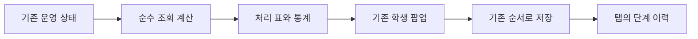

# 관리자 운영 도구

관리자 화면의 **운영 도구**에서 처리 목록, 주간 통계, 통합 저장 이력과 서버 상태를 확인한다. 기존 학생 팝업과 저장 API를 그대로 사용한다.

## 화면과 데이터 경계

| 기능 | 구현 | 기준 |
|---|---|---|
| 공지 영상 검색 | `searchableSelect.js` | 기존 공지 영상 선택값과 공용 한글 검색 규칙. 새 영상 생성 기능 없음. |
| 처리 목록 | `operationsProjection.js` | 현재 렌더된 오늘/하원 행의 정확한 날짜·SID. 자습을 제외한 출석/숙검 요청 후 미검사, 학생별 백지리뷰 대기, 출석 학생의 선택일 배정 중 명시적인 미완료 영상 진도 기록. 해당 날짜의 진도 기록이 없는 영상은 완료 여부를 추정하지 않고 제외한다. |
| 주간 통계 | `operationsProjection.js` | 관리자 선택일을 포함한 7일. SID 단위 출석 표시, 숙검 기록 완료율, 날짜별 영상 진도 기록 완료율. 사람이 같은 과목별 SID는 별도로 센다. |
| 저장 이력 | `saveOperations.js` | 이 탭 세션의 최근 30개 통합 저장 시도. SID·날짜·작업 ID·단계·시각만 기록한다. 숙제, 메모, 저장 payload를 보관하지 않는다. |
| 서버 상태 | `operationsToolkit.js` | 창을 연 동안 현재 origin의 `/api/ping` 확인. Uptime Kuma는 별도 프로세스에서 운영 origin과 공개 `/app`을 감시한다. |

숙검 분모에는 `hwAssigned`, `hwCheckRequested`, `hwChecked` 중 참인 기록이 있는 항목만 포함한다. 영상 분모에는 해당 날짜 진도 기록의 `done`, `assigned`, `interrupted`, `none`만 포함한다. `skip`, 시험, 메타데이터는 제외한다. 기록이 없으면 비율은 null이며 화면에는 `기록 없음`으로 표시한다. 따라서 이 비율은 전체 수강생 성취율이나 배정 대비 완주율을 뜻하지 않는다.

통계는 열기/새로고침 시 기존 날짜별 API를 사용하고, 날짜 1개씩 읽으면서 해당 날짜의 독립 조회 3개만 병렬 실행한다. 늦게 온 이전 날짜 응답은 화면에 적용하지 않는다. 로그 GET의 기존 SQLite schema/WAL 부작용은 [운영 데이터 규칙](../AGENTS.md#runtime-data-safety)을 따른다.



저장 순서·충돌·수동 상태의 권위는 [기존 관리자 저장 계약](PROJECT_FUNCTIONS_AND_LOGIC.md#admin-latency-contract)이 소유한다. 저장 이력은 관찰 기능이다. 여러 저장 API를 하나의 원자적 트랜잭션으로 바꾸거나 실패한 단계를 자동 재실행하지 않는다. 실패 단계 내부에서 일부 저장됐을 수 있으므로 기존 팝업에서 값을 확인한 후 재시도한다. 재시도는 새 작업 ID로 구분한다. 새로고침 시 진행 중이던 시도는 `완료 확인 불가`로 표시한다.

## 외부 라이브러리

공식 npm 배포물만 `static/vendor/`에 보관한다. 버전과 npm SHA-512는 [가져오기 스크립트](../scripts/vendor_admin_toolkit.py)에 고정한다. [자산 manifest](../static/vendor/admin-toolkit-manifest.json)는 파일별 SHA-256과 다운로드 출처를 기록한다. LICENSE와 필요한 NOTICE를 함께 배포한다. 외부 CDN이나 frontend package runner 없이 필요한 창에서만 로드한다.

```powershell
python scripts/vendor_admin_toolkit.py
node scripts/verify_admin_operations_toolkit.mjs
```

## Uptime Kuma 운영

공식 [Uptime Kuma](https://github.com/louislam/uptime-kuma)의 검증한 Git commit을 manager에 고정한다. 설치·데이터·로그·프로세스 영수증·암호화된 초기 자격 증명은 모두 무시되는 `instance/uptime-kuma/` 안에 있다. 학원 JSON/SQLite를 읽거나 복사하지 않는다. 외부 알림 채널은 등록하지 않는다.

```powershell
powershell -NoProfile -File scripts/manage_uptime_kuma.ps1 Status
powershell -NoProfile -File scripts/manage_uptime_kuma.ps1 Install
powershell -NoProfile -File scripts/manage_uptime_kuma.ps1 Start
powershell -NoProfile -File scripts/manage_uptime_kuma.ps1 Configure
powershell -NoProfile -File scripts/manage_uptime_kuma.ps1 EnableAutoStart
```

`Install`은 서비스가 멈춘 상태에서만 실행한다. `Start`는 `127.0.0.1:3001`에만 바인딩한다. `Configure`는 기존 모니터를 재사용하며 다른 설정을 초기화하지 않는다. 동일 이름의 상태 페이지가 있으면 두 모니터의 포함 여부를 확인하고 내용을 보존한다. `EnableAutoStart`는 현재 Windows 사용자 로그온 시 시작하는 작업을 등록한다. 로그인 전 부팅 감시나 호스트 전원 장애 감지는 제공하지 않는다.

읽기 전용 상태 화면: `http://127.0.0.1:3001/status/academy` (서버 PC에서 접속). 관리 로그인이 필요하면 서버 PC에서 `instance/uptime-kuma/credential.clixml`을 `Import-Clixml`로 읽는다. Windows DPAPI로 현재 사용자에게 암호화되어 있으므로 다른 PC로 복사해 로그인 정보를 공유하지 않는다. 암호나 Kuma 데이터베이스를 Git에 추가하지 않는다.

## 검증과 되돌리기

관련 검사: `verify_admin_operations_toolkit.mjs`, `verify_admin_startup_overlap.mjs`, `verify_admin_announcement_async_scope.mjs`, `verify_admin_popup_async_scope.mjs`, `verify_admin_css_inventory.mjs`, 전체 `verify_refactor_safety.py`. 화면 검증은 관리형 8004를 사용하며, 재시작 없이 frontend만 바뀌면 manager `Refresh` 후 재로드한다. 실제 영상 수동 상태와 저장 날짜의 회귀는 관리자 기능 가이드를 따른다.

코드는 `codex/admin-operations-toolkit` 브랜치의 이 기능 커밋만 역순으로 `git revert`한다. 다른 작업의 미커밋 변경이 같은 파일에 있으면 먼저 분리하고, `git reset --hard`나 전체 파일 복구를 사용하지 않는다. 브라우저를 재로드하면 이전 코드로 돌아간다. 코드 되돌리기는 학생 데이터나 이미 저장한 수업 기록을 되돌리지 않는다.

Kuma까지 중지하려면 **스크립트를 Git으로 되돌리기 전에** 실행한다.

```powershell
powershell -NoProfile -File scripts/manage_uptime_kuma.ps1 DisableAutoStart
powershell -NoProfile -File scripts/manage_uptime_kuma.ps1 Stop
```

`Stop`은 root·PID·생성 시각·명령줄이 영수증과 일치하는 Kuma 프로세스만 종료한다. 데이터는 남으므로 다시 `Start`하면 감시 기록을 유지할 수 있다. 운영 Flask 서버 8003과 테스트 서버 8004는 이 manager가 제어하지 않는다.
