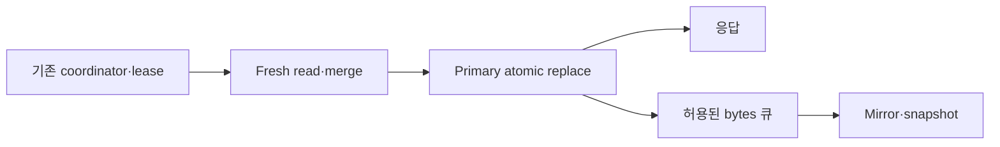
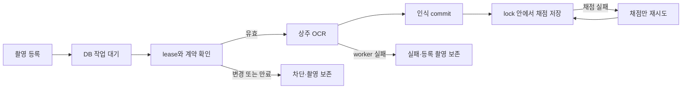
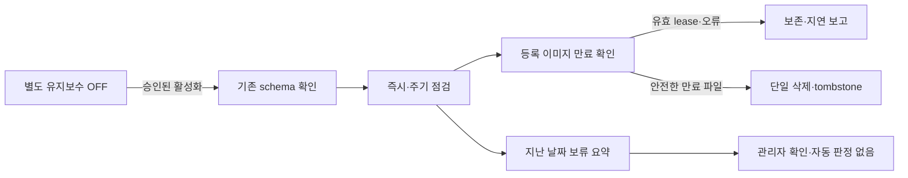

# 학원 운영 허브 — 전체 기능 및 주요 로직 기준서

**규칙 소유권·감사 기준:** [SERVER_RULES_INDEX.md](SERVER_RULES_INDEX.md)
**목적:** 기능 패치·장애 점검·코드 리뷰 때 세션을 다시 읽거나 로직을 매번 역추적하지 않도록 현재 계약을 한곳에 고정한다.

이 문서는 동작 설명서다. 작업 방법과 데이터 안전 규칙은 루트 및 하위 `AGENTS.md`가 우선한다.

## 1. 시스템 한 문장 정의

이 저장소는 학생 명단, 출결, 오늘 순서, 수업·숙제 기록, 영상 배정과 시청 진도, 시험 배정·채점·성적, 보강, 공지, 학사 일정, 자료 파일을 함께 운영하는 Flask 기반 학원 운영 허브다. 홍보 사이트나 범용 SaaS가 아니며 저장소 옆의 JSON·SQLite가 실제 운영 데이터다.

## 2. 현재 구조와 요청 경로

```text
학생/관리자 브라우저
  ├─ 기존 공개면: 5a-math.com → 로그인·기존 학생 페이지
  ├─ 학생 앱 공개면: app.5a-math.com → /app·PWA·세션 제한 API
  │    └─ Cloudflare Tunnel → localhost:8003
  └─ 학원 LAN: 서버 IP:8003
       └─ Waitress → Flask app.py → feature flag별 Blueprint → 정적 HTML/JS 또는 JSON API
```

현재 예약 작업 인자에서는 public 학생 앱만 켜고 dashboard/homework/reminders/focus는 끈다. Blueprint·URL 개수는 코드와 플래그에 따라 바뀌는 파생값이므로 문서 계약으로 고정하지 않는다. 플래그별 구성과 실제 요청·저장 흐름은 [CODE_FLOW_MAP.md](CODE_FLOW_MAP.md)를 따른다.

- 프런트 빌드 시스템과 Jinja 템플릿 트리는 없다. `static/`의 HTML과 네이티브 JavaScript를 Flask가 직접 제공한다.
- `5a-math.com`은 기존 로그인·`/student/<sid>`·공유 학생 자산을 유지한다. 학생 앱 전환 승인이 꺼진 동안 HTTP 루트도 200으로 유지하고 `/app`, manifest, service worker, 모바일 인증 API 같은 학생 앱 전용 경로는 404로 닫는다.
- `app.5a-math.com`은 HTTPS 전용 학생 앱 공개면이다. HTTP 요청은 404이고, HTTPS `/`는 cache 금지 302로 `/app`에 이동한다. `/app`, manifest, service worker와 명시 등록한 API만 허용하며 미등록 경로·메서드는 404다.
- 두 호스트는 별칭이 아니며 브라우저 저장소도 origin별로 분리된다. 학생 앱의 보호 페이지·파일·API는 유효한 앱 세션을 요구하고, 요청 SID는 세션의 `active_sid`와 같아야 한다.
- Cloudflare의 `CF-Visitor.scheme`, 일반 프록시의 `X-Forwarded-Proto`, 클라이언트 IP 헤더는 loopback, Cloudflare 대역 또는 명시한 `TRUSTED_PROXY_CIDRS`에서 온 요청에만 신뢰한다.
- 기존 학생 페이지와 별도로 학생 앱 PWA가 다시 제공되고 있다. manifest와 shell 자산은 재검증 캐시 정책을 사용하며, 인증 없는 session 조회·student bootstrap은 401로 닫힌다.

## 3. 사용자, 인증, 네트워크 경계

| 표면 | 인증·접근 | 핵심 계약 |
|---|---|---|
| 학생 로그인 `/` | 이름/계정 로그인 후 30일 JWT | `AUTH_SECRET`이 재시작 후에도 같아야 자동 로그인이 유지된다. |
| 학생 앱 `https://app.5a-math.com/app` | 학생 앱 세션 + HTTPS | 루트는 `/app`으로 302 이동한다. 허용 목록 밖 경로·메서드는 404, 세션 없는 보호 API는 401, 다른 SID는 403이다. |
| 학생 `/student/<sid>` | 학생 JWT 흐름과 sid | bootstrap의 `assignedTests`는 항상 최상위 배열이다. |
| 관리자 페이지군·활성 학생 계정 관리 API | HTTP Basic | 네트워크 위치와 무관하게 올바른 `ACADEMY_ADMIN_USERNAME`, `ACADEMY_ADMIN_PASSWORD_HASH`가 있어야 한다. 누락·오인증은 401이며 학생 앱 공개 host에서는 관리자 API를 404로 숨긴다. |
| 영상 재생 URL | 학원 네트워크 | `/api/get-url`에서 실제 클라이언트 IP·공개 세션 SID·카탈로그 MID를 검증한다. Kollus LMS callback은 외부 사업자가 호출하므로 별도 `KOLLUS_CALLBACK_SECRET`으로 보호한다. |
| 답지 맵 | 학원 네트워크 | `/js/test_answer_link_map.json` 직접 접근도 차단한다. |
| 쓰기 API | 동일 origin | POST/PUT/PATCH/DELETE의 Origin·Referer가 현재 Host와 다르면 403이다. |
| 데모 | `/demo/rh3123/*` | 데모 bootstrap이 fetch와 저장을 가로채며 실서버 쓰기를 만들면 안 된다. |

학생 계정은 `auth_accounts.json`의 호환 데이터를 사용한다. 사용자 결정 D-16에 따라 서버 환경변수 `MASTER_PW`는 레거시 학생 이름 로그인, 변경된 계정 ID 로그인, `/api/auth/change`의 현재 비밀번호 확인 모두에서 허용한다. 이름 로그인은 ID·비밀번호 변경 후에도 해당 이름의 현재 계정을 사용하며, 알 수 없는 학생·계정 ID는 거부한다. 로그인만으로 이미 있는 계정의 ID나 비밀번호 해시를 바꾸지는 않는다. 관리자 HTTP Basic이나 공개 학생 앱 인증에는 이 허용을 확대하지 않는다. 마스터 비밀번호 값은 코드·문서·로그에 기록하지 않고 Machine 우선, 예약 작업 사용자 범위 fallback으로만 읽는다. 런처는 `AUTH_SECRET`도 같은 우선순위로 읽으며 값이 없거나 기본 placeholder면 운영 Waitress가 기동하지 않는 것이 정상이다.

레거시 `/api/auth`의 계정 전체-map 변경도 학생 앱 계정 저장소와 같은 `file_lock` 경계를 사용한다. 손상·읽기 실패·잘못된 root/record 형식은 빈 저장소로 대체하지 않고 503으로 종료한다. 비밀번호 hash가 있는 계정 map은 mirror하지 않는다. 실제 로그인 ID 변경마다 `legacy_session_id`를 회전하고 JWT의 `account_session`과 비교한다. 변경 전 토큰은 `/me`·`/switch`·`/change`에서 401로 종료하며 계정을 재생성하거나 중복 정리를 하지 않는다. ID를 되돌리거나 재사용해도 이전 토큰은 복원되지 않는다. 기존 변경 응답의 새 토큰·payload는 유지하고, 이전 토큰을 가진 다른 세션은 다시 로그인해야 한다. 변경되지 않은 기존 계정의 무표식 토큰과 비밀번호만 변경한 세션 정책은 유지한다. 로그인과 인증 요청은 검증·SID 갱신·토큰 발급까지 같은 계정 파일 잠금을 유지한다. 구현·검증·반영 상태는 [후속 작업 기록](SERVER_PROJECT_FOLLOWUP_2026-10-01.txt)에 구분한다.

## 4. 화면 지도

| 경로 | 역할 | 주요 코드 |
|---|---|---|
| `/` | 학생 로그인 | `static/index.html`, `static/js/auth.js` |
| `/admin`, `/dh1130` | 날짜별 관리자 운영판 | `static/admin.html`, `static/js/admin/` |
| 관리자 학생 툴팁 | 학생 이름·출석·학교 정보 표시; 이름 옆 난이도 배지(상·중상·중·하)는 표시하지 않음 | `static/js/admin/features/hoverTooltip.js` |
| `/students` | 전체 학생 명단·미니 진도·내보내기 | `static/all.html`, `static/js/all/` |
| `/student/<sid>` | 학생 영상·시험·숙제/수업 정보 | `static/student.html`, `static/js/student/bootstrapState.js`, `static/js/student/watchState.js`, `static/js/student/playback.js`, `static/js/student/reviewPlaylist.js`, `static/js/student/announcementState.js`, `static/js/student/testPresentation.js`, `static/js/student.js` |
| `/app`, `/app/*` | 학생 앱 설치·세션 shell | `static/student-app.html`, `static/js/student-app.js` |
| `/video-manage` | 영상 카탈로그 관리 | 영상 관리 HTML/JS |
| `/tests` | 시험 카탈로그·기록·통계 | `static/tests.html`, `static/css/tests.css`, `static/js/tests/catalogState.js`, `static/js/tests/catalogEditorState.js`, `static/js/tests/catalogStatisticsState.js`, `static/js/tests.js` |
| `/school-cal` | 학교 일정 | 학교 캘린더 HTML/JS |
| `/file-manage` | 자료 폴더·파일 관리 | 파일 관리 HTML/JS |
| `/demo/rh3123/*` | 관리자 기능 데모 | `static/js/admin/demo/` |

구형 `main.html`과 잘못된 자동배정·watch 이중 쓰기를 포함하던 `student copy.html` / `js/student copy.js` 사본은 2026-08-23 제거했으며 다시 별도 로그인·학생 페이지로 복구하지 않는다.

## 5. 날짜와 식별자 계약

- 관리자 기능의 기본 기준일은 화면에서 선택한 날짜다. `getAdminDate()`를 사용한다.
- 실제 로컬 오늘이 의도된 경우에만 `todayLocalKey()`를 사용한다.
- 행 단위 작업은 해당 행의 `data-date`를 우선한다. 화면 전역 상태만 보고 다른 날짜를 덮어쓰면 안 된다.
- 학생 sid는 문자열이 기준이다. `"007"`과 `"7"` 같은 legacy alias를 읽을 때 호환하되 새 쓰기에서 임의 숫자 변환을 하지 않는다.
- 날짜 키는 실제 달력에 존재하는 정규 `YYYY-MM-DD`다. `core/date_rules.py`가 Python 서버의 공용 판정을 소유하며 `2026-02-30`, compact `20260606`, timestamp 문자열은 날짜 키가 아니다.
- 일반 날짜 기반 진도·로그·영상 배정/자습·watch·schedule override 요청은 이 판정을 저장소 load/lock, repository, hook, 알림, JSON/SQLite 쓰기 전에 수행하고 잘못된 날짜를 400으로 거부한다. 정상 payload·응답 형태는 바꾸지 않는다. 사용자 결정 D-04의 결석 전체-map 500·무쓰기 제한만 명시적 예외다.
- bootstrap과 날짜 출결·연락 조회도 compact/week/timestamp 날짜를 받지 않는다. `core/request_consistency.py`는 해당 owner가 거부할 날짜를 전역 absence lease 전에 판정하되 응답과 인증 순서는 route에 남긴다. 날짜 query를 사용하지 않는 updates GET·callback은 query만으로 lease를 생략하지 않는다.

### 사람과 과목별 SID

- `students.json`은 과목·과정별 활성 SID 행을, `persons.json`은 한 사람의 안정적인 `personId`와 SID 연결·공유 프로필을 보유한다.
- identity가 설정된 상태에서 일반 학생 추가는 새 person을 만들고, 명시적인 `cloneFromSid` 복제는 원본과 같은 person에 새 SID를 연결한다.
- `name`, `school`, `grade`, `docUrl`은 person 공유 프로필이므로 연결된 활성 SID에 함께 반영한다. `curriculum`, `subCurriculum`, `level`, `whiteReviewPending` 같은 수업·운영 필드는 SID 범위다.
- `id`와 `personId`는 일반 필드 업데이트로 바꿀 수 없다. 학생 삭제는 person을 지우지 않고 해당 SID 연결을 retired 상태로 전환한다.
- `persons.json`과 `students.json` 쓰기는 `instance/person_identity_transactions/pending.json` 저널로 함께 커밋·롤백한다. 시작 시 미완료 트랜잭션을 복구하고, 일부 identity 상태가 손실되거나 읽을 수 없으면 빈 identity·학생 저장소를 만들지 않고 관련 학생 조회와 쓰기를 503으로 닫는다.
- identity migration 전 legacy 명단은 기존 SID 동작을 유지하며, 일반 학생 추가가 identity를 부분 초기화하지 않는다.
- 전체학생 표의 공유 프로필 편집은 같은 person의 SID 행·검색키·통계에 함께 반영한다. 편집 중 중복 저장을 막고, 일부 필드만 저장된 실패에서는 명단을 다시 읽어 확인한 저장 결과를 표시한다. 저장하지 않은 다른 입력 초안을 전체 표 재생성으로 지우지 않는다.

## 6. 하루 운영 흐름

1. 관리자 bootstrap은 실제 오늘의 초기 스냅샷과 공통 상태를 읽는다.
2. 선택 날짜가 바뀌면 그 날짜의 출결, 순서, 로그, 영상/시험 상태를 다시 hydrate한 뒤 렌더링한다.
3. 출석·결석·보강·도착·연락·오늘 순서는 각 전용 PATCH/POST 흐름으로 부분 갱신한다.
4. 학생별 로그와 숙제는 의미 있는 기존 값을 빈 문자열로 지우지 않는 merge-safe 규칙으로 저장한다.
5. 영상 자동 배정은 실제 KST 오늘 날짜가 시작된 뒤 관리자 `POST /api/updates/ensure-today`, 실제 오늘 날짜 경계 감지, 비공개 오늘 bootstrap, 오늘 일정 사건이 누락된 오늘 snapshot을 최초 생성할 때만 일어난다. 미래 날짜는 자동 snapshot을 미리 저장하지 않으며, 관리자 모달은 read-only updates 조회를 사용한다.
6. 학생 시청은 `watch.json`에 위치·길이·완료·시각을 저장하고 자동 상태를 `progress.json`에 투영한다.
7. 시험 배정·답지 링크·과거 기록 조회는 유지하지만 학생 시험 제출은 제공하지 않는다.
8. 완료·하원·숙검하원은 서로 다른 정책이다. 상태 변경이 없는 버튼을 상태 완료와 혼동하지 않는다.

<a id="admin-latency-contract"></a>
### 관리자 응답성·저장 충돌 경계

- 첫 관리자 운영표의 blocking bootstrap은 그 표를 그리는 데 필요한 학생·영상·배정·로그·결석·진도·학교일정만 기다린다. 자료·교재 배정·테스트 카탈로그와 독립 패널은 팝업이 요구할 때 또는 첫 운영표 렌더 뒤에 초기화한다. 같은 동작의 독립 I/O는 병렬로 시작하고, 동시에 시작된 동일 초기화는 한 진행 중 promise만 공유한다.
- 필수 기능 모듈 다운로드와 bootstrap 조회는 겹쳐 실행하되 두 작업이 모두 성공한 뒤 기존 순서로 이벤트를 연결하고 첫 운영표를 표시한다. 공통 Escape와 테마 초기화, 데모 guard 선행 순서는 유지한다. 정렬 키와 학생 lookup은 한 동기 정렬·렌더 안에서만 재사용하고 다음 조회·저장·날짜 변경에 넘기지 않는다.
- 캘린더 인원 재계산과 보강 명단은 같은 동작에서 조회한 출결·추가등원·타임·보강 문서를 함께 사용한다. 저장 중 이전 조회가 진행 중이면 그 결과를 적용하지 않고 최신 조회를 공유한다. 조회 완료 직전의 저장도 무효화를 놓치지 않으며, 다음 독립 재계산은 서버를 다시 읽는다.
- 학생 통합 팝업의 짧은 읽기 cache는 날짜·SID·URL 범위가 명확하고, 실패 promise를 즉시 제거하며, 저장 성공 뒤 관련 범위를 무효화하고, 최신 권위 응답 전 편집을 잠그는 경우에만 허용한다. 네 조건 중 하나라도 없으면 cache를 추가하지 않는다.
- HTTP 200이어도 필수 조회 문서의 형식이 잘못되면 실패로 취급하고 즉시 재조회할 수 있어야 한다. 로그 history와 기존 entry fallback이 모두 실패하면 숙제 편집·숙검 완료를 잠그고, 통합 저장도 영상·진도 쓰기를 시작하기 전에 차단한다. 재시도는 원래 SID·날짜·열기 세션 범위에 한정하며 폐기된 세션의 늦은 응답은 공유 상태를 덮지 않는다.
- 테스트 저장은 첫 비동기 요청 전에 SID·날짜·변경 키를 고정하고 같은 팝업 세션의 중복 호출은 한 저장 작업으로 합친다. 저장 중 해당 팝업 편집은 잠그며, 이전 세션의 응답은 새 팝업의 편집 상태를 초기화하지 않는다. 진도와 후속 로그가 모두 성공한 뒤에만 `저장 완료`를 표시한다. 후속 로그 실패는 진도 부분 성공을 명시하고 재시도할 변경값을 보존한다.
- 기록·통합 저장 중에는 학생 팝업의 대상 전환과 사용자 닫기를 잠근다. 단계 사이에 SID·날짜·열기 세션이 달라지면 후속 저장을 중단한다. 통합 저장은 여러 API의 순차 저장이며 전체 원자성을 보장하지 않는다. 영상 저장은 첫 요청 전에 커리 외 항목 분류를 고정하고, 이전 세션의 응답이 새 학생의 진도 수정·재배정 토큰을 지우지 않게 한다.
- 통합 저장의 영상 단계는 권위 조회·초기 화면·현재 선택의 목록과 출처가 같고 진도·재배정·추가 영상 정리·실패 재시도가 없을 때만 생략할 수 있다. 비정규 저장 형식, 빈 자동 배정, 미래 자동 배정과 명시적 삭제·수동 저장은 기존 절차로 처리한다. 기록·시험의 저장 조건은 독립이며 영상→기록→이월→시험 마지막 순서를 유지한다.
- 저장 버튼의 대기 표시는 첫 비동기 요청 전에 적용하고 실패 후 원래 표시와 재시도 상태를 복구한다. `저장 완료`와 저장 후 닫기는 필요한 서버 저장이 확인된 뒤 수행한다. 팝업의 첫 표시 전에 스크롤을 초기화해 표시 직후의 강제 레이아웃 계산을 줄인다.
- 보강·결석 명단은 열기 세션과 날짜가 일치하는 응답만 적용한다. 불러오는 동안 저장을 잠그고, 닫기와 Escape는 진행 중 읽기를 무효화한다. 저장 중에는 대상 변경을 막고 위·아래 저장 버튼을 함께 잠근다. 공통 Escape 처리도 각 모달의 상태를 관리하는 닫기 함수를 사용한다.
- 보강 명단의 SID·선택·타임 라벨은 한 렌더 안에서만 재사용한다. 빈 검색으로 새로 만든 행에는 같은 표시 상태를 다시 쓰지 않으며, 예약된 포커스도 같은 열기 세션이 남아 있을 때만 실행한다. 테스트 드래그의 최근 보기 저장은 범위 적용마다 한 번 수행하되 기존 마지막 유효 행의 값을 유지한다.
- 통합 저장에서 앞선 기록 저장이 SQLite·JSON 모두 성공했다고 명시한 경우에만 동일 날짜·SID·세션의 이월 중복 쓰기를 생략한다. 최신 로그를 다시 읽어 저장할 모든 이월 필드가 같은지 확인하며, 부분 성공·불명확한 응답·변경된 내용은 기존 쓰기를 유지한다. 시험 마지막 저장 순서는 바꾸지 않는다.
- CSV 가져오기는 카탈로그 저장·revision 재조회·목록 표시 후 완료를 알린다. 통계 조회는 별도로 진행하고 최신 조회 세대만 화면에 적용한다. 숙제 미흡 알림의 첫 조회 중 등록한 새 알림은 늦은 조회나 조회 실패에도 보존하며 ID 중복을 제거한다.
- 파일 관리의 트리·학생·배정 조회는 병렬로 시작하되 실패한 묶음으로 배정을 실행하지 않는다. 저장 중 시작한 새로고침은 커밋 완료 뒤 최신 배정을 읽는다. 배정 명령은 클릭 시 항목을 고정하고, 저장 대기 중 새로 담은 항목을 지우지 않는다.
- 관리자/전체학생의 공용 팝업 import는 같은 버전 키를 사용한다. 정적 JS·CSS는 페이지 재로드 때 HTTP 재검증하며, 검사는 과거 날짜 문자열이 아니라 두 소비자의 버전 일치와 실제 응답을 확인한다.
- 브라우저의 자동 재시도는 구조화된 `*_lock_timeout` 또는 동등한 legacy lock-timeout 응답에만 허용한다. `retryable: true`만으로 revision conflict를 재시도하지 않으며, 실제 revision/base conflict는 최신값 재조회나 사용자 확인 없이 덮어쓰지 않는다. 응답과 안내에는 raw lock 경로나 근거 없는 “다른 사용자/컴퓨터” 표현을 노출하지 않는다.

### 백지리뷰 검사 대기

- 오늘 학생 표와 하원 명단의 `백지` 체크는 해당 SID 학생이 백지리뷰 검사를 받지 못하고 귀가해 다음 등원 때 우선 검사해야 함을 뜻한다. 두 명단은 같은 현재 SID 상태를 읽고 저장하므로 하원 후 체크해도 다음 등원까지 유지된다. 과거 날짜의 하원 행에서도 당시 로그가 아닌 현재 검사 대기를 편집한다.
- 권위 원본은 `students.json`의 정확한 불리언 `whiteReviewPending`이다. 선택 날짜, 출결, 하원 로그, 숙검하원, 기록 정리, 영상·시험 진도와 독립이며 이 흐름들은 값을 자동으로 지우거나 바꾸지 않는다.
- 관리자가 검사 완료 후 같은 체크박스를 명시적으로 해제할 때만 `false`로 바뀐다. 문자열·숫자 같은 불리언 아닌 쓰기는 400으로 거부하고 명단 원본을 변경하지 않는다.
- 화면 열 순서는 `진도 → 백지 → 작업 → 보강 → 문서`다. `진도`와 `백지`는 각각 36px이며, `작업`만 기존 268px에서 232px로 줄인다. `보강` 64px, `문서` 56px와 오늘 학생 표의 전체 colgroup 폭은 유지한다.
- 하원 명단은 `커리큘럼 → 백지 → 작업 → 문서` 순서로 같은 체크박스를 표시한다. `백지` 36px를 `작업` 268px 중에서 배분해 232px로 만들며 전체 열 폭 880px와 나머지 열 폭은 유지한다. 같은 SID의 여러 날짜 행은 체크·저장 중 잠금·실패 복원을 함께 반영하고, 다른 SID의 상태는 바꾸지 않는다.

## 7. 출결·오늘 순서·보강

- 출석, 결석, 도착 시각, 연락 상태는 각각 `attendance.json`, `absent.json`, `arrive_time.json`, `contact.json` 계열 API가 담당한다.
- 관리자 결석 처리(오늘 학생 행의 결석 버튼·결석 등록)에서 해당 날짜/SID가 자습이면 결석 자체와 기존 영상·테스트 배정 정리는 수행하지만 보강 대기를 만들지 않는다. 날짜별 로그의 명시적 `selfStudy`를 먼저 적용하고, 그 값이 없을 때만 해당 요일의 학생 자습 설정을 따른다. 명시적 `false`는 일반 수업 결석이므로 기존 보강 계산을 유지한다.
- 이 자습 판정은 신규 결석 트랜잭션 안에서 `makeup_carryover.json.by_absence[date][sid].state: "self-study"`로 고정한다. 별도 보강 명단 행이 아니라 자동 대기 생성의 제외 근거이며, 보강 명단·학생별 보강 수·시험 전 미예약 보강 수·보강 내보내기가 같은 제외를 사용한다. 새로고침이나 구형 화면의 후속 `open` 쓰기로 되살리지 않고, 보강 공급 회차도 소모하지 않는다. 결석 저장 실패 시 이 표시도 함께 롤백한다.
- 기존 날짜의 보강 기록을 일괄 삭제·재분류하지 않으며 활성 예약과 별도로 수동 추가한 보강은 보존한다. 이후 자습 설정만 바꿔도 이미 확정된 결석 판정은 변하지 않는다. 결석을 복구한 뒤 다시 결석 등록하면 새 명령 시점의 날짜별 자습 여부로 재판정한다.
- 보강은 `extra_attend.json`, 주말 시간은 `weekend_slots.json`, 보강 이월은 전용 carryover API가 담당한다. 앞의 두 HTTP 경계는 `routes/api_schedule_overrides.py`가 소유하고, 오늘 자동 배정 후처리는 `app.py`가 주입한 public callback으로 연결한다. 보강 예약이 먼저 저장되고 `extra_attend.json` 반영이 일시 실패한 경우에도 오늘 명단과 날짜별 출결 명단은 활성 `scheduledMakeup`을 보조 권위로 합쳐 누락을 막되, 같은 날짜의 명시적 결석은 계속 최우선으로 제외한다. 후처리 재시도 의미는 §9의 자동 배정 불변식을 따른다.
- 현재 서버의 보강 저장 투영과 브라우저의 대기·활성 예약 계산은 목적과 legacy 입력 처리가 다르다. 서버는 1·2타임과 알려진 저장 필드를 투영하며, 브라우저 조회에는 3타임·승인 메모 해석이 남아 있다. D-17에 따라 결석·수동 보강 row의 명시적 `scheduledMakeup:null`은 예약 삭제 표식으로 저장·응답·revision 왕복에서 보존한다. camelCase 키가 없을 때 `scheduled_makeup:null`도 같은 표식으로 투영하며, camelCase의 명시적 null은 legacy alias 예약보다 우선한다. 키 자체가 없는 과거 메모의 예약 해석은 유지한다. 날짜·alias·불리언·상태·unknown 필드별 나머지 실제 계약과 검증 범위는 [정규화 대조 기록](SERVER_MAKEUP_NORMALIZATION_CONTRACT_2026-10-01.txt)에 있다. 이 선택은 다른 의미 통일이나 운영 데이터 일괄 재정규화 승인이 아니다.
- 결석과 보강의 연결을 교정할 때 대상 보강일에 `attendance.json` 출석 기록 또는 SQLite/JSON 수업 로그가 있으면, 그 날짜의 출석·추가등원·주말 타임·도착 시각·수업 로그를 삭제·이동·덮어쓰지 않는다. 잘못된 연결은 `makeup_carryover.json`의 상태·note·`scheduledMakeup`·ownership만 좁게 교정하고, 실제 출석 기록은 독립 이력으로 보존한다. 과거 출석일을 소유하던 잘못된 연결을 취소할 때는 `ownedExtra:false`와 빈 `ownedSlots`로 만들어 이후 취소 동작도 보존된 출석 기록을 해제하지 못하게 한다.
- 보강 캘린더의 예약 변경·이월은 기존/새 보강일의 정확한 SID에 대해 최신 출석과 수업 로그를 병렬 조회한 뒤 저장한다. 출석 플래그 `true`/`1` 또는 비어 있지 않은 로그 entry가 있으면 그 날짜의 추가등원·타임·도착 시각 저장을 생략하며 연결만 교정한다. 조회 실패·형식 오류는 저장 전에 중단한다. 정규화로 빈 ownership 슬롯이 빠져도 `ownedExtra:false`인 연결에서 슬롯 소유권을 다시 추론하지 않는다. 이는 프런트 사전 검사이며 여러 API 호출 전체의 원자 잠금은 아니다. 검사 후 동시 출석 저장까지 서버에서 보장하는 전용 트랜잭션은 별도 보강이 필요하다. 이 규칙은 새로운 런타임 일괄 교정 승인으로 해석하지 않는다.
- 오늘 학생 검색은 이름·학교·과목 값을 서로 다른 검색 경계로 취급한다. 학교·과목에도 이름과 같은 초성·두벌식 영타 검색을 적용하며, 띄어쓴 키워드는 필드가 달라도 AND로 검색한다. 한 키워드의 초성을 이름 끝과 학교 시작 등 서로 다른 필드에 걸쳐 합성해서는 안 된다.
- 오늘 순서의 유일한 원본은 `data/today_order.json`이다. 루트 `today_order.json`은 2026-08-24 백업·통합 후 제거됐으며 다시 만들지 않는다.
- D-19: 오늘 학생 표는 기존 타임·자습·출석·숙검 요청 및 요청 시각·숙검 상태·등원시간의 자동 정렬 우선순위를 유지한다. 이 조건들이 모두 같으면 해당 날짜에 저장한 드래그 순서를 이름보다 먼저 적용하며 새로고침 후에도 유지한다. 저장 순서에 없는 새 학생은 같은 조건의 저장된 학생 뒤에서 가나다순으로 정렬하고, 저장 순서가 없는 날짜는 기존 가나다 정렬을 유지한다. 날짜별 저장은 기존 PATCH 계약을 사용하며 과거 순서 데이터는 일괄 변경하지 않는다.
- 오늘표의 완료는 수업 로그의 `done`과 연결되지만 결석·출석·하원 버튼의 의미와 동일하지 않다.
- 관리자 운영판은 2026-08-29부터 실제 KST 오늘보다 이전 날짜의 `arrive_time.json` 등원시각과 수업 로그를 대조해, 명시적 결석이 아니고 그 날짜의 현재 유효 명단(정규 등원·추가등원·활성 `scheduledMakeup`, 결석 우선 제외)에 계속 속하면서 같은 날짜 로그가 `done:true`가 아닌 학생만 하원 누락으로 경고한다. 보강을 다른 날짜로 옮기거나 취소해 옛 날짜 명단에서 빠진 뒤 남은 등원시각 흔적은 경고 근거가 아니다. 명시적 `scheduledMakeup:null`은 오래된 snakeCase 예약보다 우선한다. 완료 상태는 일반 로그 조회와 같은 SQLite·JSON 보충 규칙으로 판정하며, SQLite의 명시적 false와 완전 snapshot의 필드 부재는 유지한다. 2026-08-28의 불완전한 과거 흔적, 오늘·미래 및 현재 선택한 날짜는 집계에서 제외한다. 2026-10-11 요청에 따른 최신 표시는 `과거 하원 기록 확인 · N건`과 각 행의 날짜·학생·등원시각·하원 완료로 저장되지 않았다는 근거이다. `날짜 확인`은 기존 선택 날짜 전환을 사용하며 하원 상태를 자동으로 쓰지 않는다. 기록 정리 경고는 `날짜 · 기록 정리`와 장식용 SVG를 유지한다. 각 경고는 빠른 작업 두 칸의 전체 폭을 쓰며 둘 다 있으면 하원 경고부터 세로로 배치한다. 내부 스크롤과 버튼 영역 겹침은 금지한다. 두 요약은 전체 로그 내용을 브라우저로 보내지 않고 첫 표 렌더 뒤 병렬로 읽는다.
- “숙검하원”은 오후 6시 전 연강 학생을 제외하고, 오후 6시 이후에는 포함한다. 자습 학생은 포함한다.
- 학생 툴팁은 선택 운영일 기준으로 중간 시험 종료 다음 날부터 기말 정보를 표시한다. 유효한 과목별 하루 시험일을 종료일로 우선하고, 없으면 학교 시험기간의 마지막 날을 사용한다. 종료 당일까지는 중간 정보를 유지하며, 기말 날짜·범위가 미입력이어도 지난 중간 정보로 되돌리지 않는다. 이 전환은 표시할 시험 선택만 바꾸며 학교 일정의 활성 시험 설정·저장된 일정·학생 기록은 변경하지 않는다.
- 학생 툴팁의 시험 전 출석 횟수는 화면에 표시되는 정규 등원요일과 같은 규칙으로 선택 운영일의 다음 날부터 시험 시작 전날까지 센다. 현재 선택일 수업을 남은 회차로 다시 포함하지 않으며, `selfStudyDays`로 지정된 자습 요일은 정규 등원 표시와 횟수 양쪽에서 모두 제외한다. 과목 시험일이 하루로 확정되면 학교 시험기간 시작일보다 우선하고, 과목 일정 행이 없더라도 같은 학교·학년의 공통 시험기간이 하나로 확정되면 그 기간을 사용한다.
- 시험 전 출석 횟수에는 같은 기간의 활성 보강 예약과 추가등원도 포함한다. 정규 수업과 추가 보강 모두 타임당 1회로 세며, `일1·일2` 연강으로 남은 등원일이 3일이면 정규 수업은 6회다. 날짜·SID·타임이 같은 정규 수업/예약/추가등원 반영은 중복 집계하지 않는다. 명시적 날짜 결석은 그날의 모든 회차, 타임 결석은 해당 회차만 제외한다. 이동한 예약은 새 날짜만 사용하고 취소한 예약은 제외한다. 보강 예약은 저장됐지만 추가등원 반영이 누락된 경우에도 예약 자체를 포함한다.
- 시험일 전에 발생한 미예약 보강 대기가 있으면 `N회 (+n회 : 보강 잡자!)`로 표시한다. `n`은 기존 보강 대기 계산(`buildPendingMakeups`)을 재사용하며 본 횟수에 미리 더하지 않는다. 이미 처리하거나 시험 이후로라도 예약한 결석분을 미예약으로 되살리지 않는다. 관리자 운영 팝업·이름 툴팁·전체학생의 공유 팝업이 같은 계산을 사용한다. 조회 중/실패는 명시적으로 표시하고 실패를 보강 0건으로 취급하지 않는다.
- 연강/보강/주말 slot 배열은 기존 문자열 sid와 다중 slot 호환을 유지한다.
- 결석 전체 저장에 실제 달력에 없는 `YYYY-MM-DD`가 신규로 들어오면 현재 500을 반환하는 알려진 제한이 있다. 사용자 선택 B에 따라 선행 400 검증은 추가하지 않았으며, 이 실패는 모든 관련 저장소 무변경·무알림이어야 한다.

## 8. 수업 로그와 숙제

### 저장 원칙

- 논리 원본은 `LogRepository`다. SQLite가 우선이며 `logs.json`은 호환 fallback·mirror 역할을 한다.
- 같은 날짜/sid가 두 저장소에 있으면 SQLite의 의미 있는 필드를 보존하고 JSON은 빠진 필드만 좁게 채운다.
- 위 결손 보충은 기존 legacy 행에 적용한다. 새 PATCH/batch 저장은 JSON의 기존 고유 필드를 먼저 합친 뒤 완전한 SQLite 행을 확정한다. 내부 저장 표식 `__logRepositoryCompleteV1`이 있는 행은 필드의 부재도 권위 값이므로 JSON에서 삭제된 메모·배정을 되살리지 않는다. 표식은 API·내보내기에서 제거하며 클라이언트 입력으로 설정하지 못한다. 기존 운영 행을 일괄 변환하지 않는다.
- SQLite base 충돌은 JSON에도 쓰지 않고 재시도 불가 409를 반환한다. SQLite 실패는 JSON-only 쓰기로 우회하지 않는다. SQLite 성공 뒤 JSON 미러만 실패하면 기존 부분 성공 응답을 유지하되 재조회는 확정된 SQLite snapshot과 일치한다. 손상된 JSON은 빈 맵으로 덮어쓰지 않고 저장을 중단한다.
- 단일·batch 로그 저장 모두 SQLite commit 뒤 JSON mirror 실패를 `ok: true`, `sqlite: true`, `json: false`와 warning으로 알린다. 이 응답은 저장 실패로 간주해 중복 command를 만들 이유가 아니며, 재시도와 재조회에서도 확정된 SQLite 상태가 기준이다.
- 저장은 `routes/log_repository_provider.py`의 `get_log_repository()`를 통하고, 순수 병합·충돌 규칙은 `core/log_rules.py`에 둔다. 기존 `routes.api_basic` import 경로는 호환 재노출이다.
- 큰 `logs.json` 호환 병합은 파일 identity·mtime·size signature가 읽기 전후 안정된 경우에만 process-local cache를 재사용한다. 교체 중 signature가 계속 바뀌면 그 snapshot을 cache하지 않고 다음 호출에서 다시 읽으며, 경로 수는 16개로 제한한다. 호출자에게 반환하는 로그 entry/map은 방어 복사해 cache 원본을 오염시킬 수 없게 한다.
- `LogRepository`의 호환 JSON 저장은 공백을 줄인 compact 형식을 사용한다. 데이터 값·미지 필드·잠금·원자 교체·동기 미러·복구 순서는 유지한다. 공용 `save_atomic`의 기본 형식이나 다른 저장소의 계약은 바꾸지 않는다.
- 빈 값은 명시적 clear/delete 계약이 없으면 기존 교재, 숙제표, 메모를 지우지 않는다.
- 알 수 없는 필드와 legacy 숙제 행 메타데이터도 보존한다.
- 일부 GET은 SQLite 스키마/WAL을 보장할 수 있으므로 운영 데이터 관점에서 완전한 무변경 읽기로 간주하지 않는다.

### 화면 의미

- 학생 페이지의 수업·숙제 미완료 패널은 로그의 완료/보관 상태를 읽는다.
- 전체 학생/관리자 팝업은 같은 로그 계약을 공유하되 선택 날짜를 유지한다.
- 숙제 검사 팝업은 입력칸 자체가 위치를 설명하므로 교재·이번 숙제/진행률·코멘트·다음 숙제 헤더 문구를 표시하지 않는다.
- 숙제 검사 팝업에서 한 교재 행의 이번 숙제·진행률·코멘트·다음 숙제를 모두 비운 채 `숙검 완료`를 누르면, 화면에 제시된 직전 숙제를 그 행의 이번 숙제로 확정하고 진행률 `0%`로 같은 로그 저장에 포함한다. 일반 `저장`, 재운 교재, 사용자가 값을 하나라도 입력한 행에는 이 자동 이월을 적용하지 않는다. 저장된 이번 숙제는 다음 등원일의 직전 숙제 원본이 된다.
- 교재의 `재우기`는 회색·입력 잠금 상태로 바꾸고, 재워진 행에는 `재움`을 표시한다. 클릭 순간에는 현재 행 순서를 유지하며 다음 팝업 열기에서 재운 교재를 아래로 정렬한다. 숨긴 코멘트 UI나 재우기 상태가 기존 교재·코멘트·숙제 데이터를 삭제하는 동작으로 확대되면 안 된다.
- 마지막 재운 교재를 깨우는 저장은 `sleepingHomeworkBooks: []`와 해당 필드의 명시적 clear를 함께 보낸다. 현재 날짜의 빈 배열 표식을 유지해 과거 재움 상태의 자동 이월을 막으며, 일반 빈 값의 병합 보호나 다른 로그·교재 필드는 바꾸지 않는다.
- 단순 `하원`과 `숙검하원`은 하원 완료만 기록하며 시험 상태를 바꾸지 않는다.
- `기록 정리`는 하원 완료 행을 최종 보관하는 별도 명령이며, 이때만 시험 완료 전이를 수행한다.

### 내보내기 계약

- `명단 내보내기`의 영상 텍스트는 선택일 배정 snapshot에서 선택일 전에 이미 `done`이었고 선택일에 명시적으로 재개되지 않은 차시는 제외한다. 선택일 당일 처음 완료됐거나 비완료 상태로 다시 연 차시는 유지하며, 같은 날 배정된 테스트와 함께 출력한다.
- `로그 내보내기` TXT와 CSV `progress` 열은 같은 비완료 변화 목록을 사용한다. 둘 다 `done`(파란색)을 제외하고 `interrupted` 같은 비완료 변화만 표시하되, CSV의 고정 14열 구조는 유지한다.
- 두 내보내기의 테스트 텍스트는 현재 커리큘럼에서 상태가 `assigned`(초록색)인 배정 이름만 사용한다. `SCHOOL_PAST`는 `학군지(난이도) 회차 이름`, `ILSAN_PAST`는 `일산(난이도) 회차 이름`으로 표기하며, 채점 정보는 제외하고 테스트 이름마다 실제 줄바꿈을 넣는다.
- 선택일의 `하원 안 하고 로그 내보내기`는 `hwChecked:true`이고 아직 보관되지 않은 로그만 포함한다. `done:true`는 필요 없으며 하원·기록 정리 상태를 변경하지 않는다. 일반 모드는 학생별 최신 미보관 하원 로그를 대상으로 한다.
- 내보내기 전 최신 요약/선택일 로그에서 대상을 확정하고 그 SID·날짜 범위의 로그·진도를 `no-store`로 다시 읽는다. 전체 이력 읽기는 구형 요약 응답의 호환 폴백뿐이다. 조교 학생 메모는 TXT·CSV 어디에도 포함하지 않는다.

### 기록 정리 상태 전환 계약

| 최신 권위 상태 | 시험 처리 | 로그 처리 |
|---|---|---|
| 진도 `assigned` | `done`으로 전환 | 같은 시험의 배정 메타데이터를 완료로 정리 |
| 진도 `done` | 유지 | 로그의 남은 `assigned` 메타데이터가 있으면 완료로 동기화 |
| 진도 `interrupted` | 유지 | 완료로 올리지 않음 |
| 진도 `skip` | 유지 | 완료로 올리지 않음 |
| 진도에 명시적 흰색(`none`/explicit blank) 키가 있음 | 유지 | 완료로 올리지 않음 |
| 진도에 해당 시험 키가 없고 최신 로그에는 배정이 있음 | 로그를 보조 근거로 `done` 생성 | 완료로 정리 |
| 해당 날짜 결석 학생 | 시험 전이 생략 | 최신 로그 검증 후 행만 보관 가능 |

권위와 실행 순서는 다음과 같이 고정한다.

1. 개별 정리는 클릭한 행의 `data-date`와 sid, 일괄 정리는 `#doneWrap`에 현재 표시된 모든 고유 `(date, sid)`를 대상으로 한다. 선택 날짜 이전 행도 포함하되 화면 밖 이력은 임의로 정리하지 않는다. 최신 조회는 표시된 날짜별로 한 번씩 모으며 각 행의 날짜는 고정한다.
2. 브라우저의 `state.logs`, `state.progress`는 렌더링 캐시일 뿐 정리 시점의 권위가 아니다. 값이 비어 있지 않아도 최신이라는 뜻으로 사용하지 않는다.
3. 먼저 `/api/logs/entry?date=...&sid=...`를 `no-store`로 다시 읽는다. 응답이 실패·비JSON·빈 entry이거나 최신 entry가 `done != true` 또는 `archived == true`면 즉시 중단한다.
4. 결석이 아니면 해당 날짜·SID의 진도도 `no-store`로 다시 읽는다. 정상적인 정확한 날짜/sids 응답에서 SID가 생략된 것은 단일 SID endpoint와 같은 권위 있는 빈 진도다. 응답 형식 오류는 중단하며 캐시로 보충하지 않는다.
5. 상태 판정은 최신 진도를 우선한다. 최신 진도에 시험 키 자체가 없을 때만 최신 로그 배정 메타데이터를 누락 보정용 근거로 사용한다.
6. 쓰기는 `progress tests patch`를 먼저 성공시킨 뒤, 시험 메타데이터 patch와 `archived: true`를 한 로그 patch로 저장한다. YouTube 카탈로그가 있으면 같은 progress 요청에 `completeAssignedYouTube: true`를 포함하며 서버가 §9의 정확한 배정만 완료한다. 개별·일괄 정리 모두 `completeAssignedTestsForRecordCleanup()`을 거쳐야 한다.
7. 최신 조회 또는 progress patch가 실패하면 로그 보관을 호출하지 않는다. 화면에는 실패를 알리고 행은 미보관 상태로 남겨 재시도할 수 있게 한다.
8. progress patch 성공 뒤 로그 patch만 실패하면 시험은 완료이고 행은 미보관인 복구 가능한 중간 상태다. 재시도는 같은 결과를 만드는 멱등 동작이어야 한다.
9. 단순 `하원`, `숙검하원`, 하원 취소에서 이 helper를 호출하거나 시험·YouTube 상태를 암묵적으로 변경하지 않는다.

현재 최신 조회와 두 저장은 서로 다른 API 호출이므로 완전한 원자 트랜잭션은 아니다. 정리 도중 다른 화면에서 새 시험을 배정하는 경쟁이 실제로 반복되면 프런트 재조회 횟수를 늘리는 방식으로 덮지 말고, 서버의 날짜/sid 단위 전용 정리 endpoint와 잠금·버전 검증으로 승격한다.

필수 회귀 검증은 `node scripts/verify_record_cleanup_test_status.mjs`다. 최소한 개별/일괄 정리, 비어 있는 캐시, 값이 있는 stale cache, `assigned → done`, `interrupted/skip/명시적 흰색` 보존, 최신 조회·progress patch 실패 시 무쓰기·무보관, 원격 하원 취소 시 무보관을 포함한다. 이 검증은 `python scripts/verify_refactor_safety.py` 기본 suite에서도 실행되어야 한다.

## 9. 영상 카탈로그와 배정

### 카탈로그 식별자와 저장

- `videos.json`의 `id`는 영상 관리 행의 안정적인 숫자 ID다. Kollus `mid`는 기존 media content key를 유지한다. YouTube `mid`는 단일 영상 `ytv_<videoId>_r<rowId>`, 재생목록 `ytp_<playlistId>_r<rowId>`이며 같은 원본을 다른 과정에 등록한 행은 별도 진도 키를 갖는다. 새 행 ID는 현재 유효한 숫자 ID의 최댓값 다음 값으로 만든다.
- 영상 관리 화면은 Kollus 또는 YouTube URL을 해석하며 `routes/api_videos.py`의 `/api/videos` POST는 잠금 안에서 카탈로그 전체를 저장한다. 일반 모드에서는 새 행 추가와 제목·챕터·과정·같은 MID의 URL 보정만 허용한다.
- 기존 안정 ID가 사라지거나 같은 ID의 URL-derived MID가 달라지면 서버는 쓰기 전에 409를 반환하고 화면은 마지막 저장 상태로 복구한다. 일반 POST에 우회 flag는 없다. 수정 모드는 마지막 저장본을 기준으로 브라우저에서 별도 JSON 초안만 만들며 서버 POST를 하지 않는다. 실제 적용은 `apply_video_catalog_correction.ps1`의 dry-run → Waitress 정지 → 런타임 백업/hash 확인 → 4개 store 일관 변환 → 재시작 절차로만 수행한다.
- 실제 사용 순서는 [VIDEO_CATALOG_CORRECTION_MODE.md](VIDEO_CATALOG_CORRECTION_MODE.md)를 따른다.
- 영상 목록 GET과 성공 204 저장은 `X-Store-Revision`/ETag를 반환한다. 일반 저장의 identity 검사 뒤 같은 VID 잠금 안에서 `If-Match`를 비교한다. 오래된 버전은 409, 잘못된 버전은 428이며 저장하지 않는다. `JSON_STORE_REVISION_MODE=soft`는 버전 없는 옛 호출만 경고 후 허용한다. strict는 버전 없는 호출도 428이다. 초기 로드 실패나 충돌 뒤 화면은 저장 대기를 중단하고 새로고침을 요구한다.

<a id="youtube-gichul-overlay"></a>
### YouTube와 기출엄선 병행 (2026-09-13 승인)

- YouTube의 `provider`, `youtubeKind`(`video`/`playlist`), `youtubeId`, `youtubeStart`, `mid`, 정규화 URL은 서버가 허용한 실제 호스트·경로에서 산출한다. `watch?v=...&list=...`는 단일 영상, `/playlist?list=...`는 재생목록 한 건이다. 공유·embed·Shorts 주소와 시작 시각을 지원하며 재생목록을 개별 영상으로 확장하지 않는다. 제목·과목·과정·챕터는 관리자가 입력한다.
- 같은 과목/세부과정의 같은 원본 영상 또는 재생목록 중복은 시작 시각·공유 파라미터가 달라도 거부한다. 재생목록과 별도로 등록한 구성 영상은 독립 배정·완료 단위다. 외부 목록 변경은 플레이어에 반영되지만 서버의 제목·배정·완료 기록을 재작성하지 않는다. 시작 시각은 별도 차시 식별자가 아니다.
- 기출엄선은 영상 카탈로그의 세부과정이다. 학생은 `students.json.gichulSelectionEnabled`라는 정확한 boolean SID 필드로 병행 설정하며 누락은 OFF이고 쓰기의 잘못된 타입은 400이다. 기존 curriculum/subCurriculum, personId/SID, 출결·진도 이력은 유지한다. 기본 과정은 기존 curriculum과 subCurriculum을 함께 비교한 범위다. 다른 SID에 복제하지 않으며 설정 저장이 배정 hook을 호출하지 않는다. 운영 사용처는 기출엄선이지만 다른 과정의 YouTube 등록을 하드 차단하지 않는다.
- 병행 ON에서 **새 자동 snapshot 후보만** 같은 과목의 기출엄선으로 고른다. 후보가 부족하거나 없어도 기본 과정으로 보충하지 않는다. 기존 과정에 미완료가 있어도 새 후보에서 제외하고 완료 처리하지 않는다. 기본 개수·A:Ble 기본값·연강 배수는 그대로다. ON/OFF 모두 이미 존재하는 오늘/과거 배정을 바꾸지 않으며 OFF 뒤 새 자동배정은 원래 과정으로 돌아간다. 오늘 즉시 추가하려면 명시적 수동 배정을 사용한다.
- 병행 ON의 복습 범위는 같은 과목의 현재 기본 과정 + 기출엄선 중 `done`뿐이다. 모든 과거 과정이나 다른 과목을 열지 않는다. 서버 자습 선택도 이 범위에서 대상일보다 엄격히 이전의 완료만 허용한다. OFF는 새 복습 후보를 기본 과정으로 제한하되 기존 진도·배정 기록을 삭제하지 않는다.
- YouTube는 기존 학생 개인페이지의 단일 iframe에서 학원망 판정 뒤 재생 URL을 받아 `autoplay=0`으로 로드한다. 재생 시작은 YouTube 플레이어의 사용자 클릭이다. 별도 YouTube 배지는 붙이지 않는다. 같은 접근 범위의 `YouTube에서 열기` 링크를 제공해 소유자 embed 제한 등 플레이어 내부 오류에도 사용자가 원본을 열 수 있게 한다. 외부 응답에서는 재생 URL과 별도 provider ID 필드를 제거하며 `/api/get-url`도 학원망·SID 검증을 유지한다. MID는 운영 식별자이지 비밀 접근 토큰은 아니다.
- YouTube에는 server/browser watch·시청률·이어보기·Kollus bridge·새 watch 세대가 없다. 자동배정/수동 등록된 초록은 실제 시청 여부와 무관하게 **기록정리에서만** 파랑이 된다. `하원`·`숙검하원`은 완료시키지 않는다. 기록정리 명령은 요청별 결석 배타 barrier 안에서 최신 로그의 `done=true`, `archived!=true`, 비결석을 요구하고 정확한 date/SID updates·잠금 후 progress를 확인한다. 영상의 초록은 배정 MID가 남아 있고 progress가 누락/빈 값/`none`/`assigned`인 상태이며 시험의 explicit blank와 다르다. 흰색 해제는 배정에서 MID가 제거된 상태다. 이 초록 YouTube만 `done`으로 좁게 patch하고 제거된 흰색은 건드리지 않는다. 주황(`interrupted`)·제외(`skip`)·기존 `done`은 배정 여부와 무관하게 유지하며 Kollus·다른 날짜/SID도 보존한다. 시험 progress와 같은 저장 경계를 쓰고 실패 시 수업 로그를 보관(`archived`)하지 않는다. progress 성공 뒤 별도 로그 저장 실패의 재시도/비원자 경계는 §8과 같다. 파랑은 수업 운영상 완료이지 시청 증거가 아니다.
- 원본 영상의 재생 가능성·광고·연령/로그인·임베드 제한은 YouTube가 정한다. 실시간 전용 `/live/` 주소는 거부한다. 별도 provider 조회가 없으므로 일반 `/watch?v=...` 주소가 실제 라이브인지까지 자동 판별하지 않으며 라이브 등록은 운영 대상에서 제외한다. YouTube 자체 통계 수집을 server가 차단한다는 뜻은 아니다. 별도 학생 앱 연동은 이번 범위 밖이다.
- 검증은 `verify_youtube_video_feature.py`/`.mjs`, 기존 카탈로그·자동배정·bootstrap·watch·복습·기록정리 회귀, 관리형 8004 실제 브라우저를 구분한다. `/api/video-capabilities`의 exact true와 catalog `X-Video-Providers: kollus,youtube`가 없는 구서버에서는 신규 YouTube/병행 설정을 저장하지 않는다. 최신 progress 응답의 `X-YouTube-Record-Cleanup: 1`로 정리 지원을 확인하므로 오래된 브라우저 catalog만 보고 명령을 생략하지 않는다. Python 운영 반영과 외부 embed 실재생 증거는 자동검사 통과와 별개다.

### 배정 유형

| 유형 | 의미 | 주의 |
|---|---|---|
| 자동 `source: "auto"` | 서버가 실제 오늘의 수업·과정·과거 진도를 기준으로 오늘 최초 생성한 snapshot | 미래 날짜에는 저장하지 않는다. 생성 뒤 고정되며, 오늘의 명시적 과정 변경으로 저장 MID가 현재 과정 밖이 된 경우만 재배치한다. |
| 수동 `source: "manual"` | 관리자가 학생·날짜에 명시적으로 저장 | 교차 과정 추가 영상과 명시적 빈 배정을 포함하며 자동 로직이 덮지 않는다. |
| 자습 `source: "selfStudy"` | 서버가 자습일의 과거 완료 영상을 지정 | `/api/updates/self-study`가 자습·결석·보관·완료 이력을 다시 검증한다. |
| 학생 “영상 등록” | bootstrap이 허용한 완료 영상을 당일 개인 재생목록에 추가 | `updates.json` 배정 유형이 아니다. `student:review-playlist:<sid>:<date>` localStorage에만 저장한다. |

`routes/api_updates.py`가 `GET /api/updates`, `POST /api/updates/patch`, `POST /api/updates/self-study`의 HTTP 검증·응답·잠금 merge 경계를 소유한다. `routes/api_student_bootstrap.py`는 `GET /api/student/bootstrap`의 입력, public active SID, 학원망 판정, 공개 응답 link/watch projection과 no-cache 응답을 소유하고, Flask-free 집계 payload는 `routes/student_bootstrap_projection.py`가 만든다. `app.py`는 `api_basic.py`의 공개 호환 hook과 bootstrap dependency bundle을 각 전용 경계에 주입한다. SID 별칭·배정 merge/source 규칙은 `core/update_assignment_rules.py`, `updates.json`의 엄격한 object 저장 경계와 잠금 파라미터는 `core/update_assignment_store.py`가 소유한다. 날짜·slot·자습·결석 해석은 `core/student_schedule_rules.py`, 현재 과정·완료·차단·복습 응답 projection은 `core/student_video_projection.py`, 자습 과거 영상 선택과 자동 배정 append/rebase 변환은 `core/student_video_assignment_rules.py`가 순수 규칙으로 소유한다. `routes/student_auto_assignment_service.py`가 주입된 path·I/O·repository·lock·clock으로 real-today 초기화와 자습 reconcile의 runtime orchestration을 소유하며, `api_basic.py`에는 dependency factory와 기존 함수명의 얇은 wrapper만 남는다.

브라우저에서는 `static/js/student/bootstrapState.js`가 public-session loader 또는 비공개 bootstrap·latest-watch 병렬 요청을 주입받아 기존 9칸 초기 상태로 투영한다. `static/js/student/watchState.js`는 주입된 SID·날짜·학원망·request·clock을 사용해 localStorage resume/watch 병합, epoch-millisecond snapshot, 1500 ms trailing debounce와 연속 진도 중 고정 10초 저장 시도, 실패 재시도와 `/api/watch` flush를 담당한다. `static/js/student/playback.js`는 active MID, resume query, `/api/get-url`, HTTPS upgrade, iframe Kollus attach/poll, 동일 window/MID 진도 event를 주입형 controller로 소유한다. `static/js/student/reviewPlaylist.js`는 주입된 SID·날짜·storage 안에서 `student:review-playlist:<sid>:<date>` key, fresh bootstrap 자격 기준 prune, 선택 순서, 등록·취소를 소유하며 DOM·fetch·서버 쓰기를 갖지 않는다. `static/js/student/announcementState.js`는 공지·게시판 입력을 엄격히 정규화하고 미확인/완료, 확인·설문·답장 전이, 답장 3회 제한, 필터와 중복 없는 페이지 병합을 소유한다. `static/js/student/testPresentation.js`는 배정 시험의 unknown-field 보존 정규화·중복 제거, 상태/일산 난이도 라벨, 답지 alias와 학원망 접근, 카드 metadata·미완료 수·모바일 동일 탭 규칙을 소유한다. 두 모듈은 DOM·fetch·ambient storage를 갖지 않는다. `static/js/student.js`는 public active SID 반영, 서버 권위 `reviewVideos` access/blocking, 캐시 hydrate, 배정 해석, playlist/DOM badge, page lifecycle, player ready/empty, 시험 카드 element·클릭 안내, 공지 endpoint 호출·modal/carousel/form·접근성·사용자 피드백, board scroll과 오류 문구를 담당하며 bootstrap 실패 시 구형 다중 GET fallback 없이 중단한다.

### 자동 배정 불변식

- 서버 자동 배정의 최초 생성 진입점은 실제 오늘을 대상으로 한 관리자 `POST /api/updates/ensure-today`, 관리자 30초 실제 오늘 경계 감지, 비공개 real-today 학생 bootstrap, 오늘 보강·weekend slot 변경이다. 서버가 자정에 실행 중인 관리자 화면을 만나면 30초 이내 생성하고, 화면이 닫혀 있으면 첫 오늘 관리자/학생 접근이 같은 멱등 함수를 실행한다. 미래 보강·일정 변경과 미래 날짜 조회는 storage-only이며 `source: "auto"`를 만들지 않는다. 관리자 영상 모달은 반드시 `/api/updates?readOnly=1`로 연다.
- `/api/extra-attend` PATCH는 기존 날짜 명단 교체와 `deltas:{date:{sid:true|false}}`를 지원한다. delta는 EXTRA 잠금 안에서 요청한 SID만 추가·제거하고 다른 SID, 순서, 날짜를 유지한다. 응답 `dates`는 실제 저장 결과이며 후속 슬롯·등원 처리에 사용한다. 캘린더는 열 때의 선택 기준과 저장 직전 명단을 합쳐 원격 추가와 퇴원 SID를 보존한다. 필요한 조회 실패 시 첫 저장부터 차단한다.
- 실제 오늘을 명시한 `/api/extra-attend` PATCH는 저장 내용이 이미 같아 `changedDates`가 비어도 멱등 자동 초기화를 다시 실행한다. 앞선 동일 요청이 `extra_attend.json` 저장 뒤 후처리에서 실패했을 수 있기 때문이다. 첫 실패는 성공으로 숨기지 않고 오류 응답을 유지하며, 동일 payload 재시도는 저장소를 다시 바꾸지 않은 채 후처리를 복구한다. Weekend slot과 학생 일정·과정 수정은 원래부터 요청/필드 기준으로 동일 후처리를 다시 실행한다. 정상 성공 status·body는 바꾸지 않는다.
- `updates.json`은 파일이 없을 때만 빈 object `{}`로 해석한다. 파일이 존재하지만 읽을 수 없거나 최상위 값이 object가 아니면 조회·PATCH·자동 초기화·자습 reconcile을 503으로 닫고 원본 바이트를 그대로 보존한다. 손상 상태를 빈 배정으로 바꾸어 저장해서는 안 된다.
- 대상은 정규 수업 또는 보강 등록 학생이며 결석과 `done` 로그는 제외한다. 자습은 일반 대상 판정과 분리된 명시적 일일 모드다.
- 학생별 설정은 기본 개수 1~6개, 기본값 3개, A:Ble 기본값 1개다. 오늘의 weekend override와 slot 결석을 반영한 실제 슬롯이 인접하면 유효 개수는 2배가 된다.
- 사용자 승인 2A에 따라 backend 공용 coercion도 최대 6개로 통합한다. 6보다 큰 기존 roster 값은 파일을 일괄 수정하지 않고 새 날짜 snapshot 계산에서 6으로 해석하며, 이미 존재하는 오늘·과거 snapshot은 축소·재작성하지 않는다. 이후 관리자 설정 저장은 1~6으로 정규화된다.
- 자동 후보는 학생의 정확한 현재 curriculum/subCurriculum 안에서 chapter 순으로 고른다. 기출엄선 병행 ON은 위 계약에 따라 새 후보의 세부과정만 기출엄선으로 바꾼다. nonblank subCurriculum이 맞지 않을 때 과목 전체 fallback을 쓰지 않으며 다른 과정은 관리자 수동 추가만 허용한다.
- 대상 날짜까지의 `done`과 `skip`은 자동 후보에서 제외하고, 그보다 미래인 progress/watch 레코드는 후보 판정에 사용하지 않는다. 자동 `interrupted`는 이어볼 수 있고, 나중의 수동 `none`/`interrupted`는 완료 이력을 명시적으로 다시 열 수 있다.
- 미래 `source: "auto"` snapshot은 만들거나 유지하지 않는다. `/api/updates/patch`는 잠금 안에서 기존 배정과 요청을 병합한 최종 `source`를 검사하므로, 기존 미래 자동 항목에 `source`를 생략한 PATCH도 거부한다. 명시적 삭제 또는 최종 `source`를 `manual` 등 자동이 아닌 값으로 바꾸는 정리는 허용하고, real-today 초기화 경계는 이미 남은 미래 자동 항목만 정리한다. PATCH body는 object여야 하며 `remove`가 있으면 JSON boolean만 허용한다. 문자열·숫자·null 등 모호한 삭제 표시는 400으로 거부하고 원본을 바꾸지 않는다. 미래 수동·자습과 출처를 확정할 수 없는 legacy 항목은 별도 명시 배정으로 보존한다.
- L-13의 고정 snapshot 계약에 따라 오늘 자동 snapshot은 progress/watch 완료, 일반 일정·연강, 학생별 개수 변경으로 전진·축소·삭제·보충하지 않는다. 모든 배정 영상이 `done`/`skip`이어도 통합 팝업의 로그 저장은 그 날짜 배정을 삭제하지 않으며, 같은 날 다음 영상을 재배정하지 않는다. 개수 변경은 다음 날짜 경계에서 사용할 학생 설정만 저장한다.
- L-14에 따른 일반 자동 reconcile 불변식의 명시적 시스템 예외는 새 결석 `(date, sid)`의 원자 트랜잭션이다. 이 트랜잭션은 해당 날짜 배정을 제거하며, 결석 취소는 배정을 자동 복원하지 않는다. 모든 real-today 자동 초기화와 self-study reconcile은 결석 coordinator barrier를 먼저 잡고 그 안에서 권위 `absent.json`을 다시 읽은 뒤 updates 잠금을 잡는다. 따라서 자동배정이 먼저 끝나면 뒤의 결석 커밋이 삭제하고, 결석이 먼저 끝나면 자동배정이 새 결석을 보고 생성을 건너뛰며, 삭제 직후 stale 판정으로 배정을 되살리는 제3의 결과는 허용하지 않는다. 같은 요청에서 이미 잡은 동일 coordinator barrier는 재진입 가능하지만 다른 스레드·프로세스는 계속 배제한다. 관리자의 명시적 수동 재배정·clear는 자동 reconcile이 아닌 별도 사용자 동작이다. 명시적 과정 재지정은 기존 snapshot에서 현재 과정 밖 MID만 교체하고, 현재 과정 안의 완료 MID와 원래 슬롯 수는 가능한 범위에서 보존한다. 수동 빈 저장은 명시적 clear로 남긴다.

### 학생 복습 등록과 자습 배정

- `/api/student/bootstrap.reviewVideos`가 학생 복습 후보의 유일한 권위다. 요청 날짜까지의 현재 과정(기출엄선 병행 시 위에서 정의한 두 과정) `done` 영상만 포함하므로 같은 날 방금 완료한 영상도 후보가 될 수 있다. `interrupted`, `skip`, `none`, 미완료, 허용 범위 밖 과정은 제외한다.
- 학생 웹은 `/api/student/bootstrap` 실패 시 오류를 표시하고 초기화를 중단한다. 학생·영상·배정·자료·결석·로그 API를 따로 호출해 일부 데이터만 조립하던 구형 7개 요청 fallback은 제거되었으며 다시 사용하지 않는다.
- bootstrap은 후보를 chapter/MID 순으로 정렬하고 raw progress/watch와 event date를 제거한다. 학원 외 응답에서는 URL·재생 권한도 제거하고 `playbackRestricted`만 남긴다. 현재 재생목록에 표시 중인 MID는 중복 복습 후보에서 제외한다. 실제 오늘의 비자습 `source: "auto"` 배정은 완료 후에도 파란 상태로 재생목록에 남으므로 복습 후보에 중복 표시하지 않는다. 그 밖에 완료 후 재생목록에서 빠진 허용 MID는 복습 후보로 다시 보일 수 있다.
- 학생의 체크와 “영상 등록”은 서버 배정 쓰기 없이 localStorage에 선택 순서대로 저장하고 현재 재생목록 뒤에 붙인 뒤, 새 등록이 성공하면 페이지를 한 번 강제 새로고침해 bootstrap부터 플레이어 표면을 재구성한다. 새 bootstrap 후보에 없는 저장 MID와 중복은 매 로드 때 제거한다. 등록 행을 실제 재생할 때만 `/api/get-url`을 호출하며 Kollus만 bridge·`/api/watch` 흐름을 사용한다.
- 일반일과 자습일의 chooser UI는 같다. 결석, 보관, ghost, course-blocked, malformed bootstrap에서는 숨기고, 학원 외 네트워크에서는 제목만 보여 주며 등록·재생·watch 쓰기를 금지한다.
- 서버 자습 배정은 별도다. `/api/updates/self-study`는 target date보다 엄격히 이전에 완료한 현재 과정 MID만 받고, 기존 비-selfStudy 수동 배정을 보호한다. 학생의 로컬 “영상 등록” 버튼은 이 endpoint를 호출하지 않는다.

## 10. 시청 기록과 진도 상태

### 원본과 필드

아래 watch/시청 임계값·재배정 세대 계약은 Kollus 전용이다. YouTube의 무시청기록·운영상 기록정리 완료는 §9가 정본이다. `watch.json`의 날짜/sid/mid 레코드는 다음 필드를 가진다.

| 필드 | 의미 | 병합 |
|---|---|---|
| `last` | 가장 멀리 본 초 위치 | 큰 값 유지 |
| `dur` | 영상 길이(초) | 큰 값 유지 |
| `completed` | 완료 여부 | 한 번 true면 자동 replay가 false로 내리지 않음 |
| `updatedAt` | JavaScript epoch milliseconds wire 값 | 정수화 후 큰 값 유지 |

- 브라우저와 Kollus callback은 `updatedAt`을 epoch milliseconds로 보낸다. 브라우저는 bitwise 절단 없이 정규화하고, 서버는 유효한 밀리초 값은 보존하며 과거 32비트 절단값은 수신 시 현재 밀리초로 교정한다.
- `verify_student_watch_timestamp.mjs`와 `verify_watch_timestamp_guard.py`가 브라우저 직렬화와 서버 수신 교정을 검사한다.
- `core/watch_store.py`는 UTF-8/BOM root와 주소 지정한 date/SID/MID branch를 엄격히 읽는다. 누락만 빈 상태이며 손상/읽기 실패/non-object 대상은 503으로 종료해 progress·알림을 새로 만들지 않는다. 정상 MID 저장은 기존 unknown metadata와 다른 branch를 보존한다.
- 5% 이상 시청은 자동 `interrupted`, 90% 이상 또는 완료 이벤트는 자동 `done`이다.
- 길이를 모르는 상태에서 위치가 0보다 크면 시작으로 본다.
- `progress.json`은 화면 상태의 권위 원본이며, 같은 날짜/mid의 watch보다 우선한다.
- 과거 `done` 후 나중에 재생한 `interrupted`는 완료 이력을 자동 취소하지 않는다.
- 브라우저는 Kollus controller의 ready/progress/play/pause/done 이벤트와 3초 polling을 localStorage에 병합하고 1.5초 trailing debounce로 `/api/watch`를 저장한다. 연속 진도 이벤트가 저장을 무기한 미루지 않도록 첫 미저장 진도부터 고정 10초 안에 저장을 시도하며, 영상 전환·pagehide·숨김은 즉시 flush한다. flush·reset·watch cycle 변경은 두 timer를 모두 취소한다. 공식 SDK 조회·재개 메서드는 `get_progress()`와 `set_current_time(seconds)`다. watch 저장은 실패해도 로컬 재생 위치를 유지하며 다음 동기화에서 다시 시도한다.
- `/api/watch`와 Kollus callback은 같은 monotonic watch 병합 및 자동 progress writer를 사용한다. 완료가 유효하게 저장되어도 자동 배정 reconcile을 호출하지 않으며 날짜별 snapshot은 그대로 유지한다.
- `routes/api_progress.py`가 `/api/progress`의 날짜·단일 SID·batch SID 조회와 `/api/progress/patch`의 잠금 merge·compact 저장·post-save milestone 알림을 소유한다. 자동 배정과 bootstrap은 같은 `core.progress_store`를 읽지만 이 HTTP Blueprint를 import하지 않는다.

### 수동/자동 우선순위

1. 명시적 수동 상태와 `__manualProgressMids`
2. 기존 자동 상태와 `__autoWatchProgressMids`
3. 새 watch 자동 투영
4. 비어 있는 기본값

자동 업데이트는 수동 흰색(`none`), 수동 `skip`, 수동 `interrupted`를 덮지 않는다. 자동 `interrupted`는 자동 `done`으로 올라갈 수 있다. 자동 빈 값은 자동 미완료를 지울 수 있지만 완료를 내리지 않는다.

### 명시적 초록 재배정과 새 시청 기준 (2026-09-12 승인)

- 관리자가 영상 행을 초록(`assigned`)으로 명시적으로 바꾸고 저장하면 해당 날짜/SID/MID의 수동 진도 고정을 해제하고 **재배정 이후 새 시청**으로 다시 5%/90% 완료를 판단한다. 팝업을 열거나 변경 없이 저장하는 동작은 새 시청을 시작하지 않는다. 영상 목록의 `source: manual` 보호는 계속 유지된다.
- `progress.json`의 `__videoWatchCycles[mid]`가 현재 세대 token·시작 시각·새 시청 누적값을 소유한다. 일반 progress 값은 초기 `none`과 자동 소유 metadata를 사용한다. 기존 `watch.json`의 단조 증가 이력은 삭제·초기화하지 않으며, 과거 완료값을 새 세대 진도나 학생 재생 위치에 합치지 않는다.
- `/api/progress/patch`의 명시적 `resumeAutoWatch` 명령만 세대를 만든다. token/baseToken으로 중복 저장은 같은 세대를 유지하고, 뒤늦은 다른 창의 재배정은 409로 막는다. 학생 bootstrap/watch 최신 조회는 요청일까지의 마지막 세대를 투영한다. 다른 학생·영상과 미래 날짜의 세대는 영향을 주지 않는다.
- 학생 `/api/watch`는 세대 token을 보낸다. 이전 플레이어의 값이면 새 진도를 쓰지 않고 409를 반환하며 학생 페이지는 새 기준으로 다시 불러온다. Kollus 재생 URL은 세대가 있을 때만 그 token을 서명된 callback 값에 묶는다. 이전/세대 미포함 callback은 과거 watch 이력만 보존하고 새 진도를 완료시키지 않는다.
- 이후 흰색·수동 주황·제외로 바꾸면 수동 상태 우선 규칙이 다시 적용된다. 전체학생 조회 전용 팝업은 새 시청 명령을 만들지 않는다. 과거의 수동 `none` 기록은 일괄 해제하지 않는다.
- 구버전 서버는 capability header가 없으므로 새 재배정 명령을 저장 전에 차단한다. 프런트 변경만으로 운영 반영 완료로 보지 않으며, Python 변경은 별도 승인된 재시작이 필요하다. `verify_video_watch_rearm.py`/`.mjs`와 기존 watch·bootstrap·배정·결석 검증군을 함께 유지한다.

## 11. 시험 배정·답지·과거 기록

- 카탈로그 원본은 `tests-config.json`이다. `tests.json`과 legacy 로그의 기존 성적은 읽기 전용 과거 기록이며 학생 화면에서 새 기록을 만들지 않는다.
- 2026-09-12 사용자 결정: 앞으로 시험 데이터를 추가할 때는 테스트 관리 페이지 등록과 함께 빠른 인쇄기 CSV 등록 명단·자료ID 매핑도 갱신한다. 명명·자료ID·인쇄 블록 규칙은 [빠른인쇄기 서버 CSV 연동](codex://threads/01a04790-ad02-70d0-b710-3a6358a6fa56) 작업의 최신 승인 내용과 실제 인쇄기 등록 원본을 먼저 확인하며, 시험명이나 자료ID를 임의로 추정하지 않는다.
- 동반 갱신 대상은 `core/resources/quick_printer_registered_tests.csv`와 `scripts/build_quick_printer_test_mapping.py`가 생성하는 `core/resources/quick_printer_test_mapping.json`이다. 기존 자료ID·등록 행·인쇄 블록·OMR 규칙 및 주문 CSV 양식을 보존하고, 신규 시험의 누락·중복·잘못된 매핑 여부를 생성 결과와 무인쇄 CSV preview로 검증한다. 인쇄기 원본이 없어 등록하지 못한 항목은 미완료로 명시하며 페이지 등록만으로 연동 완료를 보고하지 않는다. 실제 종이 인쇄, 운영 재가동, Drive 수정은 각 작업의 별도 승인 범위를 따른다.
- 학생별 배정 상태의 원본은 `progress[date][sid].tests`다. 로그의 `assignedTests`는 메타데이터·호환 fallback이며 명시적으로 비운 배정을 되살리면 안 된다.
- 완료된 시험을 하양(미배정)으로 명시 변경하면 해당 시험 키를 삭제하지 않고 `tests[시험키] = {"status":"none","explicitBlank":true}`로 남긴다. `__testsClearedAt`가 함께 저장되어도 다음 수업은 이 명시적 하양을 우선 계승한다. 완료에서 주황(`interrupted`, 배부)이나 빨강(`skip`, 제외)으로 바꾼 경우에도 선택 상태를 progress 원본에 저장하고 다음 수업까지 계승하며, 이전 완료·로그 메타데이터가 되살리지 않는다. 기록 정리는 `assigned`만 완료로 바꾸고 하양·주황·빨강을 보존한다. 과거 시험 결과 자체는 지우지 않는다.
- 빠른 인쇄기 CSV는 선택한 타임 학생 중 현재 과목의 `assigned` 테스트만 기존 카탈로그 순서로 내보낸다. CSV가 성공 생성될 때 포함된 각 배정을 `app.sqlite`의 `quick_printer_export_history` 테이블에 `(student_id, test_id, material_id, assignment_date)` 복합 키로 기록하며 preview·빈 결과·미매칭·저장 실패는 이력을 남기지 않는다.
- 현재 로그의 `testAssignmentAbsenceSourceDate`와 출처 로그의 `testAssignmentAbsenceCarryover.assignedTests`가 정확히 같은 시험을 가리키며 출처 항목의 당시 상태가 `assigned`이면, 이월 체인으로 복원한 최초 배정 키의 과거 빠른 인쇄기 이력 유무와 관계없이 자동 제외할 수 있다. 이 규칙은 이력 기능 도입 전에 출력된 결석 이월도 재출력 대상에서 구분하기 위한 것이다. 결석과 무관한 수동 상태 변경, 출처 당시 `done`·`interrupted`였던 시험, 같은 학생의 다른 시험은 포함한다. 성공 생성 이력은 계속 별도 감사 기록으로 남긴다. 팝업은 자동 제외 `학생 수 · 건수`를 보여 주고, `이미 출력한 결석 이월 항목도 포함(재인쇄)`은 매번 기본 켜짐으로 연다. 사용자가 체크를 해제하면 정확한 결석 이월 재배정만 자동 제외하며, 그 결과가 0건이면 CSV를 만들지 않고 이유와 집계를 안내한다.
- `GET /api/tests-config`는 `X-Tests-Config-Revision`을 반환한다. 개별 시험 정의 추가·수정·분류 이동은 `PATCH /api/tests-config/test`와 같은 revision을 사용하며, 기존 unknown 필드와 source/답지 메타데이터를 보존하고 `clearFields`로 허용된 필드만 명시적으로 지운다.
- 전체 규칙·bulk import·명시적 삭제는 revision을 포함한 `POST /api/tests-config`를 사용한다. revision이 없거나 stale이면 428/409로 실패하고, 관리 화면은 최신 카탈로그를 다시 읽거나 저장 전 스냅샷으로 복구한다.
- `/api/tests-config`의 전체 저장은 기존 시험의 암묵적 삭제를 409로 거부한다. 삭제는 명시적 ID 목록으로 요청한다.
- 관리자 브라우저의 config/test 정규화, 검색·정렬·그룹, 재정렬 차단, revision header가 붙은 POST/PATCH 요청 투영과 rollback snapshot은 `static/js/tests/catalogState.js`가 DOM·fetch 없이 소유한다. `static/js/tests.js`는 실제 endpoint 호출, mutation lock, 편집기·CSV·목록 DOM, 저장 실패 reload/rollback 렌더와 사용자 피드백을 소유한다.
- 답안 문자열·문항 유형 정규화/검증/요약, 기존 회차 보존 merge, CSV template/cell/parser/header alias와 행별 정답·유형 투영은 `static/js/tests/catalogEditorState.js`가 DOM·fetch·파일 접근 없이 소유한다. `static/js/tests.js`는 실제 input/file/blob/download DOM, config mutation, 저장, reload와 알림을 소유한다.
- 통계 유형 라벨, ID→signature→이름 조회 우선순위, category summary, 검색·정렬, 응시 메트릭·오답 상세·기록 행 presentation은 `static/js/tests/catalogStatisticsState.js`가 DOM·fetch 없이 소유한다. 답지 링크는 `/api/tests-records` 상세 응답의 `answerUrl`만 표시하고 static map으로 fallback하지 않는다. `static/js/tests.js`는 실제 통계 endpoint, 로딩 시점, escape된 table/modal DOM, event와 feedback을 소유한다.
- `/tests` 전용 catalog/editor/statistics/modal cascade와 1024/760/640px 반응형 규칙은 `static/css/tests.css`가 소유한다. `static/tests.html`은 `main.css` → `admin.css` → versioned `tests.css` 순서로 로드하고 큰 inline style block을 두지 않는다. CSS 분리는 정규화된 분리 전 SHA-256과 shell body SHA-256을 고정하며 기능·DOM·선택자·선언 순서를 바꾸지 않는다.
- 사용자 승인 1A에 따라 parser의 compact 호환은 유지한다. 공백 없는 `1342`는 첫 문항의 단일 값이고 나머지는 빈 값이며, 화면은 다문항 입력으로 공백형 `1 3 4 2`와 쉼표형 `1,3,4,2`만 안내한다.
- 기존 키, `sourceFiles`, 답지 메타데이터를 보존한다.
- `REVIEW`, `SCHOOL_PAST`는 `sourceFiles.solutionFileId` 또는 동등 메타데이터를 유지한다.
- `UNIT` 답지는 Drive 설명 파일에서 생성한 `static/js/test_answer_link_map.json`과 동기화한다. 구형 `test_answer_link_map.js`와 `/js/test_answer_link_map.js` 주소는 2026-08-24 제거됐으며 다시 만들지 않는다.
- UNIT 해설 링크 생성은 과목·난이도·단원명 후보가 여러 개면 Drive PDF 파일명의 선행 순번과 카탈로그 `sourceOrder`가 정확히 일치하는 한 시험에만 연결한다. 순번이 없거나 여전히 여러 후보이면 링크를 만들지 않고 `ambiguous_answer_file`로 실패한다.
- 하나의 Drive `fileId`는 카탈로그 전체에서 한 sourceId/회차만 소유할 수 있다. 해설이 확인되지 않은 시험은 잘못된 PDF를 재사용하지 않고 링크를 비워 두며 `answerLinkStatus: "missing"`을 명시한다. 생성기는 이를 비치명적 `expected_missing_round`로 보고하고, 테스트 관리 목록은 `해설 미연결`로 표시하며, 검증 전까지 해당 회차의 `answerModes`를 전 문항 `manual_review`로 둔다.
- 학생 bootstrap은 `assignedTests`를 최상위 배열로 반환한다. `assignedTests[].answerUrl`은 배정의 직접 URL → config의 `sourceFiles.solutionFileId` 등 solution 메타데이터 → `static/js/test_answer_link_map.json` 순으로 해석하며, 학원 밖 응답에서는 모든 단계의 링크를 제한한다.
- 시험 배정 상태는 기본 `assigned`, 완료/정리 후 `done`이다. 화면 편의 상태가 기록 원본을 임의로 대체하면 안 된다.
- 학생별 단원평가 기본 레벨은 학생 레코드의 `testLevelDefaults.UNIT[정규화 과목]`이 원본이다. 테스트 배정 팝업의 `레벨 설정`은 Lv.3~Lv.6 GUI에서 이 필드만 `/api/update`로 저장하며, 현재 배정 상태나 관리 페이지의 공통 규칙을 함께 바꾸지 않는다.
- 학생별 기본 레벨이 있어도 일반 `난이도` 선택에는 해당 분류의 전체 난이도(UNIT은 Lv.3~Lv.6)를 계속 노출한다.
- 배정 팝업의 상태 순환·정규화·카탈로그 정렬은 `static/js/admin/features/testAssignmentRules.js`가 DOM·통신·전역 상태 없이 소유한다. `testModal.js`는 현재 과목을 주입하고 최근 보기·편집 상태·DOM·저장 순서를 소유한다. 분할은 배정 의미와 화면을 바꾸지 않으며 기존 config 정규화의 제자리 보정 계약도 유지한다.
- 테스트 배정 팝업의 최초 과목은 현재 학생 레코드의 `curriculum` 정규화값이 절대 우선이다. 학생별 브라우저 최근 보기나 배정 이력이 다른 과목이어도 최초 과목을 덮어쓰지 않는다.
- 현재 커리큘럼 과목 안에서만 첫 보기 우선순위를 최근 배정 이력의 유효 항목 → 학생별 브라우저 최근 보기(`admin.testAssignment.recentView.v1:<sid>`) → 학생별 기본값과 테스트 관리 공통 규칙 순으로 적용한다. 최근 배정은 `progress[date][sid].__testAssignmentChangeOrder`의 시험별 순번으로 판정하고, 분류 탭을 바꾸면 그 분류의 최근 배정을 우선한다. 이 우선순위는 결정 원장 D-13의 사용자 확인을 따른다.
- 최근 보기는 현재 커리큘럼과 같은 과목의 분류·난이도·고사·회차만 복원한다. 카탈로그에서 삭제되었거나 조합이 맞지 않거나 다른 과목인 저장값·이력은 무시하며, 팝업 안에서 수동으로 본 다른 과목은 다음 오픈의 시작값으로 저장하지 않는다.
- Ctrl/Cmd+클릭의 다중 선택은 배정 상태와 별개인 `선택` 표시다. 방향키 상태 순환은 왼쪽/오른쪽 모두 `흰(없음) ↔ 주(배부) ↔ 초(배정) ↔ 파(완료) ↔ 빨(제외)`의 역/정방향을 유지한다.
- 학생별 통합 팝업의 표시 이름은 `저장`이며 기존 저장 후 닫기 동작은 유지한다. 영상 배정, 숙제·수업 로그, 결석 테스트 이월을 먼저 저장한 뒤 테스트 배정을 마지막으로 저장한다. 사용자가 테스트 상태를 직접 바꾼 경우 이 마지막 저장이 권위이므로, 같은 팝업을 열 때 포착한 과거 이월 snapshot이 삭제한 초록 배정을 다시 만들면 안 된다. 테스트를 바꾸지 않은 저장은 기존 이월을 유지한다.
- 학생 시험 카드는 배정 상태와 서버가 투영한 답지 링크만 표시한다. `static/js/student/testPresentation.js`가 정규화·라벨·답지 접근·metadata view model을 만들고 `student.js`가 read-only `<a>`/`<button>` DOM과 학원 밖 제한 안내를 조합한다. 답지가 없으면 비활성이고, 학원 밖에서는 제한 안내만 표시한다.
- `/api/submit-test`, `/api/ocr-test-sheet`, `/api/ocr-test-sheet-review`, `/student-test/<sid>`는 제거되었다. `/api/tests`는 GET 전용이며 과거 기록을 쓰거나 삭제하지 않는다.
- 외부 네트워크 응답에서는 답지 URL, solution/answer 필드와 정답 키를 제거한다.

## 12. 메모·운영 이력의 분리

| 기능 | 저장/의미 | 섞으면 안 되는 것 |
|---|---|---|
| 조교 학생 메모 | SQLite 기반 thread, 작성일·작성자·색상, 편집/삭제/핀/확인일; legacy 완료 필드는 호환 상태 | 수업 로그 메모, 상담 CSV |
| 관리자 운영 노트 | 관리자 화면 운영 메모 | 학생별 조교 메모 |
| 학생 운영 로그 | 학생 관련 사건 이력, 개별/전체 삭제 | 수업 로그, 브라우저 localStorage |
| 학생 복습 재생목록 | SID/date 범위 localStorage UI 선호 | 서버 배정, 수업 로그, 상담/운영 이력 |

메모 헤더의 왼쪽에는 작성자·핀을 두고 확인일 메모의 `[확인 필요/예정] 작성일 → 확인일`은 핀 옆에 둔다. 오른쪽 끝에는 작은 `수정 · 삭제`, 본문은 반드시 다음 행이며 날짜 열 시작선 전에 줄바꿈한다. 좁은 화면에서는 헤더가 자연스럽게 줄바꿈하되 날짜와 작업 버튼을 겹치게 하지 않는다. 연도·시각·핀 옆의 중복 핀/고정 글자는 표시하지 않는다. 작성자는 고유색 태그·표식으로 구분하고 본문은 밝은 화면에서 읽히는 중립색, 고정 강조는 작성자색의 위→아래 방향이다.

조교 메모는 고정·확인일 우선순위를 유지하되 같은 우선순위 안에서는 `created_at DESC, id DESC`로 최신 작성 메모를 위에 표시하고, 목록을 열거나 새 메모를 등록한 뒤에도 맨 위를 보여준다.
관리자 운영판은 조교 학생 메모 전체 CRUD를 제공한다. 전체학생 관리페이지는 같은 학생별 쓰레드를 조회하고 신규 메모를 등록할 수 있지만, 기존 메모의 편집·삭제·핀 등 후속 변경은 잠근다. 학생 개인페이지와 내보내기에는 노출하지 않는다.

작성은 `일반 메모 / 확인일 메모`로 구분하고 확인일 입력은 본문 위에 둔다. 기본 확인일은 브라우저의 실제 로컬 오늘 다음 날부터 7일 안의 해당 학생 정규 등원일이며 선택 운영일·당일은 포함하지 않는다. 정규 요일이 없으면 빈 입력에서 직접 선택한다. 자동 문장 제안은 하지 않는다. 실제 로컬 오늘과 확인일이 같으면 `확인 필요`, 미래면 `확인 예정`, 과거면 `지난 확인일`로 표시한다. 확인일이 지난 메모도 보존하며 `확인 완료` 버튼은 두지 않는다. legacy 완료 API 필드는 UI 숨김/자동 삭제 조건이 아니다. 삭제·핀·확인일은 다른 저장소의 삭제로 확대하지 않는다.

## 13. 공지·설문·캘린더·자료

- 공지는 목록/작성/수정/삭제, 이미지 업로드/다운로드 소스, 확인, 답글·설문 제출을 지원한다. 학생 화면의 정규화·미확인/완료·확인/설문/답장 상태·답장 3회 제한·게시판 필터/페이지 병합은 `static/js/student/announcementState.js`, 실제 통신과 modal/carousel/form·접근성·피드백은 `static/js/student.js`가 소유한다.
- 학교 일정은 `school_calendar.json`과 `routes/api_school_calendar.py`가 담당하며 sheet/import 작업은 기존 학교·학기 키를 merge한다. GET은 `X-School-Calendar-Revision`과 ETag를 반환하고, whole-document POST는 직전 revision의 `If-Match`가 없으면 428, stale이면 무쓰기 409다. 화면의 순수 문서↔편집 행 projection은 `static/js/school-calendar/state.js`, GET·revision 초기화·auto/switch/flush/metadata 저장은 `static/js/school-calendar/persistence.js`가 담당한다. 저장은 한 queue로 조합하며 성공 revision을 다음 요청에 인계한다. 구형 backend가 revision header를 주지 않는 전환 구간에는 client가 header를 생략하지만, 새 backend는 428로 닫고 reload를 요구한다.
- 학교 일정 화면의 최초 연도·학기·시험 선택은 서버의 활성 페이지 메타데이터가 브라우저의 과거 선택값보다 우선한다. localStorage는 구형 문서의 누락값 폴백일 뿐이며, 이후 사용자가 명시적으로 과거 학기/시험을 선택하는 기능은 유지한다. 활성 페이지 변경은 기존 revision 저장 경계를 사용하고 다른 학기·학교의 날짜나 시험 범위를 이동·삭제하지 않는다. 2026-09-06 운영 활성 선택을 2026년 2학기 중간고사로 정정했다.
- 자료 HTTP는 `routes/api_materials.py`의 GET-only `/api/materials`와 revisioned `/api/mat-assign`, 파일 작업은 `routes/api_fs.py`가 담당한다. bootstrap은 `routes/material_state_provider.py`의 같은 path-injected coherent read를 사용한다.
- 파일 API는 tree, folder, rename, move, delete, upload를 제공한다. 한글 이름을 보존하고 폴더 하위 materials URL, assignment ID·URL·relative·DIR token, page-folder 값을 segment 단위로 함께 갱신한다. 루트 이동은 빈 dst를 사용한다. 파일 변경 전에 같은 복구 저널에 prepared intent를 기록한다. 커밋 시작 전 종료·실패는 원래 파일로 복구하고 주 JSON 바이트를 재저장하지 않으며, durable committing marker 이후는 파일 변경을 유지하고 세 JSON을 모두 완료한다. 삭제·업로드 staging은 해당 root의 `instance/`에 두며 완전히 저장된 업로드만 공개한다. /api/fs/page-folders HTTP 표면은 폐기됐지만 내부 저장소는 참조 무결성 대상으로 유지한다.
- `materials.json`, `mat_assign.json`, `page_folders.json`은 `core/material_state.py`의 file-tree → 결정적으로 정렬한 세-store 잠금과 하나의 복구 저널로 읽고 저장한다. `core/file_material_transaction.py`는 순수 경로/파일 identity 검증과 파일 복구 계획을 담당한다. `/api/mat-assign` GET의 revision을 POST `If-Match`로 돌려주지 않으면 428, 낡았으면 무쓰기 409다. 기존 version 1 metadata journal은 roll-forward하고 version 2 file intent는 prepared/committing phase에 따라 복구한다. 파일 교체 등 모호한 identity, 손상된 저널·저장소에서는 마지막 정상 snapshot으로 조회만 유지하며 파일·교재 mutation은 503이다. 이 장애는 서버의 다른 기능과 시작을 막지 않는다.
- 보강 이월과 시트 동기화는 전용 API다. 서버는 브라우저 로그인 쿠키 없이 Google CSV export를 읽으므로, 대상 시트의 일반 액세스는 `링크가 있는 모든 사용자 - 뷰어`여야 한다. 웹 게시까지는 필요 없다. 링크에 탭 `gid`가 명시되면 그 탭만 읽고, 없으면 Google이 선택하는 기본 탭을 읽으며 존재를 보장할 수 없는 `gid=0`을 임의로 붙이지 않는다. 401/403이면 원인을 JSON으로 안내하고 결석·보강 저장은 시작하지 않는다. 대량 적용 전 런타임 백업이 필요하다.
- 운영 시트 동기화는 버튼을 눌렀을 때만 실행한다. 기본 읽기 경계는 127행 포함까지, 결석 표시는 `*`만 인정하고 선택 날짜의 전월·당월을 읽는다. 학생은 이름·학교·과목으로 매칭하며 유일하게 확정할 수 없는 행은 추측하지 않는다. 날짜/SID의 기존 `absent.json` 결석을 기준으로 누락을 판정한다. 별도 감사 요청으로 130행 또는 8~10월을 살펴보는 것은 이 자동 규칙의 변경이 아니다. 누락된 결석만 기존 결석 등록 트랜잭션으로 추가하며 예약된 보강의 취소·이동·연결 재작성이나 시트 쓰기는 하지 않는다. 연결 교정은 별도 사용자 승인 작업이다.
- 비공개 시트를 연결 서비스/로그인 브라우저로 읽는 것과 위 서버 버튼의 CSV 읽기는 별개다. 현재 서버 버튼에는 비공개 시트 자격증명 경로가 없으며, 과거 채팅의 비공개 열람 성공만으로 지원된다고 판정하지 않는다. 새 인증 연동은 미구현 사항으로 남기고 쿠키·인증 gate를 우회하지 않는다.
- 비학생 OCR review cache는 내부 API이며 실제 시험 제출과 분리한다.

## 14. 주요 데이터 원본

| 데이터 | 주 원본 | 비고 |
|---|---|---|
| 사람 identity | `persons.json` | 안정적인 `personId`, 공유 프로필, active/retired SID 연결 |
| 과목별 학생 | `students.json` | 활성 SID 행; `whiteReviewPending` 등 SID 전용 운영 필드와 알 수 없는 학생 필드 보존 |
| 미완료 identity 트랜잭션 | `instance/person_identity_transactions/pending.json` | `persons.json`·`students.json`의 좁은 before-image; 복구 후 제거 |
| 영상 카탈로그 | `videos.json` | 숫자 row `id`, provider별 `mid`, URL·과정·chapter·서술형 번호; YouTube 정규화 필드는 §9 |
| 날짜별 배정 | `updates.json` | legacy/`auto`, `manual`, `selfStudy`; 학생 로컬 복습 등록은 포함하지 않음 |
| 화면 진도 상태 | `progress.json` | 수동/자동 메타키 포함 |
| 시청 위치 | `watch.json` | `last`, `dur`, monotonic `completed`, 의도된 밀리초 `updatedAt` |
| 학생 복습 재생목록 | 브라우저 localStorage `student:review-playlist:<sid>:<date>` | fresh bootstrap `reviewVideos`로 매번 교집합 정리; 서버 이력 아님 |
| 수업·숙제 로그 | SQLite `app.sqlite` + `logs.json` | §8의 legacy 보충·완전 snapshot 구분 |
| 시험 카탈로그 | `tests-config.json` | 암묵 삭제 금지 |
| 과거 시험 결과 | `tests.json` + legacy 로그 | 기존 점수·오답 조회 전용; 학생 제출 쓰기 없음 |
| 빠른 인쇄기 내보내기 이력 | `app.sqlite` → `quick_printer_export_history` | SID + 시험 ID + 자료 ID + 최초 배정일 복합 키; 성공 생성된 CSV 행만 upsert |
| 출결 계열 | `attendance.json`, `absent.json`, `arrive_time.json`, `contact.json` | 날짜/sid 부분 갱신 |
| 미완료 결석 트랜잭션 | `instance/absence_transactions/pending.json` | 진행 중에만 존재; 민감 before-image는 미러하지 않고 commit/rollback 뒤 제거 |
| 보강 | `extra_attend.json`, `weekend_slots.json` | carryover 별도 |
| 오늘 순서 | `data/today_order.json` | 단일 canonical store; 루트 동명 파일은 제거됨 |
| 학사 일정 | `school_calendar.json` | import merge + revisioned whole-document replacement |
| 학생 계정 | `auth_accounts.json` | JWT 비밀키와 별개 |
| 메모·운영 로그 | `app.sqlite` 내 분리 테이블 | 서로 다른 repository/route |
| 학생 앱 세션·계정 감사 | `app.sqlite` | session, audit, activation, throttle 테이블 |
| 학생 앱 푸시 | `app.sqlite` | subscription, outbox, bypass 테이블; VAPID/flag와 별도 |
| 학생 앱 숙제·focus·reminder | `app.sqlite` 명시적 migration | 현재 운영 DB에는 미적용이며 해당 feature flag도 OFF |
| 업로드 | `files/` | Git 코드와 분리한 운영 자료 |

`app.sqlite-wal`, `app.sqlite-shm`, `data/`, `files/`, `_data_mirror/`, `_runtime_backups/`, root `*.tmp`도 런타임 데이터다.

### JSON 저장소와 미러 처리

`core.json_store.JsonStore`와 지연 생성하는 `core.stores` registry는 단일 JSON 파일의 read/write와 content revision을 공유한다. 생성 자체는 파일을 만들거나 읽지 않는다. registry는 최대 64개 경로를 보관하며 경로를 생성 시점의 절대경로로 고정한다. students/persons/videos의 필수 파일 누락은 빈 값으로 바꾸지 않는다. identity/material/absence coordinator의 잠금 순서·저널·복구는 기존 소유자가 유지한다.

일반 `read()`는 mtime_ns·ctime_ns·size·inode가 안정된 snapshot의 방어 복사본을 반환한다. `revision()`은 같은 signature이면 SHA-256을 재사용한다. 신원·자료·계정과 쓰기 전제의 authoritative read는 캐시를 건너뛴다. 기존 lease 아래 `read_data_locked()`/`write_data_locked()`를 사용하면 버전을 필요로 하지 않는 경로에서 추가 hash와 반환 복사를 생략한다. revision이 필요한 호출은 `read_locked()`/`write_locked()`를 유지한다. 외부 도구가 모든 signature를 보존해 덮어쓰는 수동 복구에는 명시적 cache invalidation이 필요하다.

`save_atomic()`는 원본 tmp의 실제 bytes·metadata를 캡처하고 primary replace 성공 뒤 미러 job을 제출한다. 기본 `mirror="async"`와 boolean True는 daemon 하나에서 목적지별 최신 대기 job을 합쳐 처리한다. worker는 원본을 다시 읽지 않는다. `mirror=False`는 캡처·enqueue에서 제외하며 계정 map과 민감한 저널에 적용한다. `mirror="sync"` 또는 `DATA_MIRROR_SYNC=1`은 종료형 CLI/검증에서 동기 처리를 선택한다. 미러 실패는 확정된 primary 저장을 실패로 바꾸지 않는다.



snapshot의 간격·byte 중복 제거·개수 제한은 처리되는 job에 유지한다. coalescing한 중간 버전의 snapshot은 생략될 수 있다. 미러는 durable journal이 아니며 crash 때 대기 job을 잃을 수 있다. 정상 종료의 drain은 최대 5초다. 같은 프로세스의 generation과 목적지 file_lock·captured mtime fence가 오래된 job의 재덮기를 줄인다. 동일 경로·hardlink primary alias는 제외한다. 서로 다른 프로세스의 동일 mtime·벽시계 역행·수동 미래 mtime 복원까지 완전한 순서를 보장하지 않는다. 복원 작업은 기존 정지·backup·sync/drain 경계를 따라야 한다.

Windows O_EXCL이 잠금 삭제 중 PermissionError를 반환할 때만 기존 timeout 안에서 최대 세 번 다시 시도한다. 이 경로는 stale-lock 제거를 실행하지 않으며 지속적인 ACL 오류는 원래 오류로 전달한다. 기존 active-token/PID 보호는 유지한다.

### 백업 확정 경계

유지보수의 정지 완료는 8003 리스너가 사라진 시점만으로 판정하지 않는다. 해당 운영 runner에 연결된 `guard_waitress_shadow_listener.ps1` 프로세스도 종료됐는지 확인한 뒤 백업을 시작한다. 감시 프로세스는 runner 종료를 감지한 뒤 `instance/waitress-shadow-guard.log`에 마지막 종료 기록을 쓸 수 있다. 이 파일을 임의로 제외하거나 원본 변화 검사를 약화하지 않는다.

`scripts/backup_runtime_data.py`는 승인된 유지보수로 운영 서버와 다른 데이터 작성자를 정지한 뒤 실행한다. 스크립트가 서버를 자동 종료하지 않으며, 해당 서버 리스너·저장 잠금·미완료 저널이 있으면 거부한다. 정지된 SQLite 본체와 존재하는 WAL을 임시 경로에 복사한 뒤 그 복사본에 backup API를 적용하여 커밋분을 포함한 독립 DB와 integrity check를 만든다. 읽기 전용 연결도 WAL/SHM을 생성할 수 있으므로 SQLite가 운영 원본을 직접 열지 않는다. WAL/SHM을 별도 복구 파일로 묶지 않으며 격리 8004 runtime과 비밀키·일회성 승인은 제외한다. 명세 해시는 원본 재조회가 아니라 실제 압축한 바이트에서 계산한다. 복사 도중 파일 집합/signature가 바뀌거나 압축 검증이 실패하면 최종 ZIP을 공개하지 않는다. 복원 검증은 임시 경로에서만 수행하며 운영 복원은 별도 승인 대상이다.

### 결석 조회 snapshot 경계

`core/request_consistency.py`가 관련 HTTP 경로를 분류한다. 빠른 인쇄 preview/export와 하원 누락 요약도 결석 coordinator를 통과한다. 명시적인 storage-only GET은 같은 프로세스의 짧은 read cohort로 하나의 interprocess lease를 공유하고, 마지막 조회가 끝날 때까지 다른 스레드·프로세스의 결석 쓰기를 배제한다. 일반 mutation, 호환 초기화 updates GET과 오늘 bootstrap GET은 공유 조회로 분류하지 않아 잠금 승격을 피한다. 기존 rollback·recovery·동일 컨텍스트 재진입 계약은 유지한다.

루트 SQLite 정본은 `app.sqlite` 하나다. 데이터가 없고 코드 참조도 없던 구형 `vacation.db`는 2026-08-24 백업 후 제거했으며 다시 만들지 않는다.

## 15. API 그룹

- 기본 데이터: `/api/students`, `/api/videos`, `/api/updates`, `/api/progress`, `/api/materials`, `/api/school-calendar`
- /api/students와 /api/materials는 GET 전용이다. 학생 쓰기는 add/update/delete 경로가 students 파일 잠금 안에서 수행하며 전체 배열 POST는 허용하지 않는다.
- 부분 갱신: `/api/update`, `/api/updates/patch`, `/api/progress/patch`
- 자습 영상 배정: `/api/updates/self-study`
- 학생 통합 읽기: `/api/student/bootstrap`
- 시청: `/api/watch`, `/api/watch/latest`, `/api/watch-status`, `/api/get-url`, `/api/kollus/lms-callback`

`/api/watch-status`는 다른 개발컴퓨터에서 작업 중인 학생 앱을 위한 임시 호환 API다. 현재 웹 학생 화면은 `/api/watch`만 사용하며, 학생 앱을 같은 방식으로 전환해 병합하기 전에는 제거하지 않는다. 새 웹 코드에서는 `/api/watch-status`를 사용하지 않는다.

`/api/updates/review`와 `/api/updates/training-pack` 영상 배정 endpoint는 존재하지 않는다. 학생 복습 등록은 localStorage이고, 시험 카테고리 `트레이닝팩`과 영상 배정 API를 혼동하지 않는다.

`/api/updates` 기본 주소는 GET 전용이다. 영상 배정 저장은 학생·날짜 단위의 `/api/updates/patch` 또는 검증된 `/api/updates/self-study`만 사용하며, 여러 날짜·학생을 한꺼번에 합치던 기본 주소 POST는 제거되었다.
- 로그: /api/logs(GET 전용), /api/logs/patch, /api/logs/patch-batch, /api/logs/entry, 미보관 요약, 숙제 교재
- 시험: `/api/tests`(GET 전용), `/api/tests-config`(GET·전체 POST), `/api/tests-config/test`(개별 PATCH), `/api/tests-records`, `/api/tests-stats`, 관리자 빠른 인쇄기 `/api/tests/quick-printer-export/preview`·`/api/tests/quick-printer-export`; 과거 학생 제출/OCR API는 폐기하고 신규 기능 플래그 OFF의 `/api/student-test-ocr/*`는 §21로 분리
- 출결: attendance, attend, today, absent, arrive-time, contact

등원시간의 표준 주소는 `/api/arrive-time`과 `/api/arrive-time/patch`다. 접두어가 없던 옛 `/arrive-time*` 주소는 제거되었으며 다시 사용하지 않는다.

출석·연락의 기본 주소(`/api/attendance`, `/api/contact`)는 조회 전용이다. 저장은 학생 한 명씩 처리하는 각 `/patch` 주소만 사용하며, 여러 학생을 한꺼번에 저장하던 기본 주소 POST는 제거되었다. PATCH는 원본을 잠근 뒤 엄격하게 읽는다. 저장소가 없으면 새로 만들 수 있지만, 읽기 실패·손상 JSON·잘못된 날짜별 객체 구조는 503으로 거부하고 원본을 덮어쓰지 않는다.

보강출석은 `routes/api_schedule_overrides.py`의 `/api/extra-attend` 하나만 사용한다. 같은 blueprint가 `/api/weekend-slots`도 소유한다. Weekend POST는 전체 payload를 쓰기 전에 검증하며 malformed/non-object/empty body, 잘못된 날짜, 비어 있는 날짜 mapping은 400, read-only ghost는 403, 명단에 없는 SID는 404다. 이 실패들은 파일 쓰기·자동배정 reconcile·일정 알림을 모두 생략한다. 성공 응답 204와 학생별 merge는 유지한다. `/api/extra`, `/api/extra_attend`, `/api/extra-attend/all`은 실서버에 없는 옛 이름이며 사용하거나 복원하지 않는다.

새 결석 `(date, sid)`은 L-14에 따른 자동배정 고정 snapshot의 명시적 예외다. 공용 계획 규칙으로 시험 carryover를 먼저 수집한 뒤 `updates` 배정 제거, progress 시험 `assigned → interrupted(배부)`, dual class-log 정리, `absent`, 선택적 makeup carryover 순으로 반영한다. 이 묶음은 `core/absence_transaction.py`가 날짜 단위 JSON before-image와 SQLite 대상 행을 transient no-mirror 저널에 기록해 관리한다. 성공 전 어느 단계에서 실패해도 전부 복구하고 알림을 보내지 않으며, 프로세스 종료로 남은 non-committed 저널은 서버 시작 또는 다음 결석 쓰기 전에 이전 상태로 복구한다. 복구 자체가 실패하면 503/시작 실패로 닫는다. 정상 응답·revision·시험 상태 의미와 결석 취소 시 배정을 자동 복원하지 않는 규칙은 그대로다.
영상 시청 저장(`/api/watch`, `/api/watch-status`, Kollus LMS callback)과 `routes/student_auto_assignment_service.py`의 실제 배정 writer도 같은 결석 consistency barrier를 통과한다. 자동배정 writer의 잠금 순서는 coordinator → 권위 결석 read → updates lock이며, 결석 정리가 progress나 배정을 비운 직후 동시 요청이 상태를 되살릴 수 없다. 의미 계약은 §9의 L-14 불변식이 소유한다.
- 오늘 순서·보강: today_order patch, extra-attend, weekend-slots, makeup-carryover, sheet-sync
- 인증: `/api/auth/login`, `me`, `switch`, `change`
- 메모·이력: assistant-student-notes, admin-operation-notes, student-logs
- 학생 앱: `/api/mobile/auth/*`, `/api/mobile/push/*`, `/api/mobile/student/board`; homework/focus는 feature flag 조건부
- 학생 계정 관리: `/api/student-accounts`, `/api/admin/student-focus/summary`; 관리자 homework도 feature flag 조건부
- 공지: announcements, image, ack, submit
- 파일: `/api/fs/*`, `/files/<path>`
- 내부: non-student OCR review cache

엔드포인트 URL, payload 키, 응답 shape는 전용 마이그레이션 없이 바꾸지 않는다.

## 16. 코드의 기준 위치

앱 조립 모드는 [코드 흐름 지도 §2](CODE_FLOW_MAP.md#2-앱-조립-모드), 영역별 구현 연결은 [§4](CODE_FLOW_MAP.md#4-영역별-권위와-흐름)·[§5](CODE_FLOW_MAP.md#5-핵심-상태-전이)·[§7](CODE_FLOW_MAP.md#7-구조적-hotspot)을 따른다.

정확한 모듈 위치와 수정 경계는 [core](../core/AGENTS.md#where-to-look), [routes](../routes/AGENTS.md#where-to-look), [브라우저 JavaScript](../static/js/AGENTS.md#where-to-look), [관리자 core](../static/js/admin/core/AGENTS.md#where-to-look)·[features](../static/js/admin/features/AGENTS.md#where-to-look), [CSS](../static/css/AGENTS.md#where-to-look), [공통 JavaScript](../static/js/shared/AGENTS.md#where-to-look), [검증 scripts](../scripts/AGENTS.md#where-to-look)에서 확인한다.

위 지도·지침에 아직 개별 위치가 없는 학생 앱 경계만 아래에 유지한다.

| 로직 | 기준 위치 |
|---|---|
| 학생 앱 host/session 정책 | `core/student_public_surface.py`, `core/student_app_config.py` |
| 학생 앱 인증·계정 | `core/student_app_auth_*`, `routes/api_student_app_auth.py`, `routes/api_student_accounts.py` |
| 학생 앱 push/notification | `core/student_push_*`, `core/student_notification_*`, `routes/api_student_push.py` |
| 학생 앱 숙제·focus | `core/student_homework_*`, `core/student_focus_*`, 해당 route 모듈 |


## 17. 영역별 패치 점검표

| 변경 영역 | 반드시 확인할 것 | 최소 검증 |
|---|---|---|
| 관리자 UI | 선택 날짜, 행 `data-date`, Korean UTF-8, modal scroll | `node --check` + DOM/API + screenshot |
| 관리자 초기 로드·팝업 저장 | 첫 운영표 critical path, 독립 I/O 병렬·동시 초기화 single-flight, 날짜/SID cache의 실패 제거·저장 무효화·편집 잠금, lock-timeout 전용 재시도, 로그 fallback 방어 복사 | `verify_admin_latency_contracts.mjs` + `verify_log_routes.py` + `verify_progress_routes.py` + `verify_updates_routes.py` + `homework-admin.mjs` |
| 사람·학생 명단 | person/SID 연결, 공유 프로필 전파, subject 필드 격리, 배정 hook, 실패 store byte/hash 불변, 저널 rollback/recovery | `verify_person_identity.py` + `verify_person_identity_routes.py` |
| 백지리뷰 검사 대기 | exact boolean, SID 격리, 날짜·하원·기록정리 독립, 실패 rollback, 열 순서·폭·체크 영속 | `verify_person_identity_routes.py` + `verify_admin_white_review_pending.mjs` + Chrome 8004 |
| 로그/숙제 | SQLite/JSON 양쪽, 빈 값 보존, manual white reload | 관련 unit + 양쪽 endpoint + 브라우저 |
| 영상 카탈로그/MID | 숫자 ID, 일반 모드 409, 수정 모드 초안, 참조 삭제 거부, 정지·백업·롤백 적용 | `verify_video_manage_ids.mjs` + `verify_video_mid_change_guard.py` + `verify_video_catalog_correction.py` |
| 영상 자동 배정 | real-today 최초 생성, 미래 auto 금지, read-only modal, 정확한 과정, 연강 2배, 완료 후 당일 불변 snapshot, 결석 stale 재생성 차단, schedule/identity post-commit 동일 재시도, updates HTTP 단일 소유권, 손상 store fail-closed·byte 불변 | `verify_student_auto_assignment_service.py` + `verify_schedule_override_routes.py` + `verify_person_identity_routes.py` + `verify_absence_transaction.py` + `verify_student_video_assignment_rules.py` + `verify_updates_routes.py` + assignment boundary/immutability unit + video modal policy |
| 학생 bootstrap 화면 경계 | 9칸 projection, bootstrap/watch 병렬 시작, public-session 주입, 실패 시 부분 fallback 금지, script 선행 순서 | `verify_student_bootstrap_state.mjs` + bootstrap route + 학생 DOM/브라우저 |
| 학생 시청 | 5%/90%, replay done, academy gate, SID bind, millisecond wire value, flush | progress/watch unit + `verify_student_watch_timestamp.mjs` + `verify_watch_timestamp_guard.py` |
| 학생 복습 등록 | bootstrap done-only, current course, local-only registration, stale storage prune, 선택 순서·멱등성, restricted title-only | `verify_student_review_playlist.mjs` + previous-video DOM + material access + 브라우저 |
| 학생 공지/게시판 | strict payload, 미확인/완료, 확인·필수 설문·답장 3회, 페이지 dedupe, 기존 deep-link/notification 동등성 | `verify_student_announcement_state.mjs` + student-mobile board/notifications + 브라우저 |
| 공지 이미지 공개 | raw URI 단일 파일, active SID, 현재 가시 공지 멤버십, 숨김 상태, 로컬 호환 | `verify_announcement_image_access.py` + student-data/academy-gates |
| 시험 공용 경계 | direct/config/map 우선순위, tests-config 잠금 경쟁, 관리자 기록 학원 내·외 gate, private import 부재 | `verify_test_shared_services.py` |
| 학생 시험 presentation | top-level `assignedTests`, unknown-field 보존·dedupe, status/일산 라벨, 답지 alias·학원망 gate, 모바일 same-tab, read-only DOM | `verify_student_test_presentation.mjs` + answer-mobile + material-access VM + 브라우저 |
| 시험 관리 | catalog 정규화·검색/정렬/그룹, 답안/mode/CSV projection, reorder scope, revision POST/PATCH, 409 rollback, config 삭제 안전 | 두 catalog state oracle + 실제 entrypoint 회귀 + answer-mode backend/migration + temp Flask write-safety + 브라우저 |
| 시험 배정·답지·기록 | 답지 우선순위, 과거 기록 보존, 제출 경로 부재 | assignment/bootstrap/history + retired-surface 검증 |
| 빠른 인쇄기 CSV | 현재 과목 초록 배정, 타임·순서·BOM·이스케이프, 정확한 결석 이월 provenance, 배정별 영구 출력 이력, 재인쇄 기본 포함·체크 해제 시 제외, 0건 무다운로드 | `verify_quick_printer_export.py` + `.mjs` + 관리형 8004 브라우저 |
| 출결/오늘 순서 | 문자열 sid, 선택 날짜, `data/today_order.json` | route unit + 해당 화면 |
| 학교 일정 | literal 문서/행 oracle, 독립 hash, 428/409 무쓰기, 실제 두 writer 경합, save queue 직렬화·revision chain·flush | `verify_school_calendar_state.mjs` + `verify_school_calendar_revision.py` + `verify_school_calendar_save_queue.mjs` + 두 브라우저 화면 |
| 인증/프록시 | Basic fail-closed, AUTH_SECRET 지속, 신뢰 프록시, HTTPS loop 없음 | admin/auth/proxy 검증 + 실제 HTTP/HTTPS |
| 파일 | 경로 탈출 방지, 업로드/이동 참조 | file route 검증 |
| 데모 | 모든 write가 sandbox에 머무는지 | demo behavior 검증 |

공통 명령:

```powershell
python -m compileall -q app.py routes core scripts
node --check static/js/student.js
node --check static/js/student/watchState.js
node --check static/js/student/playback.js
node --check static/js/student/reviewPlaylist.js
node --check static/js/student/announcementState.js
node --check static/js/student/testPresentation.js
node --check static/js/tests/catalogState.js
node --check static/js/tests/catalogEditorState.js
node --check static/js/tests/catalogStatisticsState.js
node --check static/js/admin/features/videoModal.js
node scripts/verify_video_manage_ids.mjs
node scripts/verify_student_announcement_state.mjs
node scripts/verify_student_test_presentation.mjs
node scripts/verify_test_catalog_state.mjs
node scripts/verify_test_catalog_editor_state.mjs
node scripts/verify_test_catalog_statistics_state.mjs
node scripts/verify_tests_stylesheet_extraction.mjs
node scripts/verify_test_catalog_search_and_sort.mjs
node scripts/verify_admin_latency_contracts.mjs
node scripts/verify_student_previous_video_review.js
node scripts/verify_student_review_playlist.mjs
node scripts/verify_student_material_access_scope.js
python scripts/verify_school_calendar_revision.py
node scripts/verify_school_calendar_state.mjs
node scripts/verify_school_calendar_save_queue.mjs
python scripts/verify_refactor_safety.py --only-video-modal-assignment-policy
python scripts/verify_refactor_safety.py
python scripts/verify_academy_proxy_network_access.py
python scripts/verify_refactor_safety.py --smoke
```

`--smoke`는 live app import와 WAL/SHM 변화를 허용하므로 순수 단위 검증과 다르다. UI 변경은 reload 후 DOM/API를 먼저 확인하고 레이아웃 변경이면 screenshot까지 확인한다. 기대값은 가능하면 생산 helper와 독립된 oracle로 계산하고, route 응답·실제 파일 byte·외부에서 관찰한 동시성처럼 서로 다른 증거 표면을 결합한다.

## 18. 운영·배포 계약

- Waitress는 Windows 예약 작업 `Academy Server Waitress`로 8003 포트를 연다.
- 공개 도메인은 Cloudflare Tunnel이 localhost:8003으로 전달한다.
- 기존 호스트 `5a-math.com`의 HTTP 루트는 전환 승인 전까지 200으로 유지한다. 학생 앱 호스트 `app.5a-math.com`은 HTTP를 404로 닫고 HTTPS 루트만 `/app`으로 302 이동한다.
- Waitress와 tunnel의 로그온 종속 여부를 별도 확인한다. 사용자 로그아웃 후에도 운영해야 하면 둘 다 관리자 권한의 Windows service 또는 비대화형 작업으로 옮겨야 한다.
- Cloudflare tunnel 서비스화는 자격 증명/config를 LocalSystem이 읽을 수 있는 위치로 옮기고 관리자 권한으로 설치·검증해야 한다. 코드 패치만으로 끝나는 작업이 아니다.
- 코드 배포 전 `python scripts/backup_runtime_data.py`로 운영 데이터를 백업한다.
- 재시작 후 listener, task result, HTTP→HTTPS, HTTPS login, 학생 bootstrap, 학원/외부 gate를 확인한다.
- 운영 관리자 페이지의 지원 브라우저는 Chrome이다. 인앱 Browser는 학생·공개 화면과 관리형 격리 8004의 비운영 UI 회귀 비교에 사용하며, 운영 관리자 접속을 위해 HTTP Basic 인증을 약화하거나 우회 경로를 추가하지 않는다. 기존 두 브라우저 격리 회귀 gate는 그대로 유지한다.
- 2026-08-29 배포는 사용자 결정 D-10에 따라 네이티브 Kollus 프레임 시작을 승인 gate에서 제외했다. 이 예외는 실제 재생 성공을 뜻하지 않으며, 학원망 `/api/get-url`, SID/MID·네트워크 gate, iframe 전달, watch/progress·배정 불변과 console/DOM 증거는 계속 필수다. 향후 playback 코드를 바꾸면 기본 브라우저 회귀 계약을 다시 적용한다.
- 테스트에는 manager가 관리하는 loopback 8004만 사용한다. 작업 전 Status, 프런트 갱신 Refresh, Python/route 변경 Start -Restart를 따른다. 8003은 테스트 때문에 재시작하지 않는다. 종료는 현재 작업 전용이고 다른 사용자·작업이 더 이상 쓰지 않음을 확인한 뒤 manager Stop으로만 한다. 공유 중이거나 사용 여부가 불명확하면 유지하고 보고한다. 상세 lifecycle·검증 gate는 [격리 서버 runbook](isolated-design-server.md)을 따른다.

### 관리형 8004 영상 전용 QA 예외 (D-18)

- 2026-10-02 사용자 승인으로 `Start -Restart -KollusVideoQa`를 사용하는 검증 창에만 영상 전용 예외를 켤 수 있다. 기본값은 OFF이며 합성 SID `QAHUBNATIVE1002`와 MID `3FWqGfJP` 한 쌍만 대상이다.
- 플래그, 정규 복사 코드 경로/marker, manager receipt의 8004·코드/원본 경로·현재 listener PID/시작 시각·QA 승인 표식, 실제 loopback peer, 비공개 same-origin 요청을 함께 검증한다. 조건 누락·오류는 거부하며 운영 코드 루트와 다른 SID/MID에는 적용하지 않는다.
- bootstrap의 지정 배정 영상 행에만 서버 소유 `localPlaybackQaAllowed:true`를 부여한다. catalog에서 들어온 같은 필드는 응답에서 제거하며 복습 영상에는 부여하지 않는다. 전체 academy 판정·시험 답지·자료 제한·Basic·public·push·callback은 유지한다.
- QA get-url은 provider에 SID/uservalue0/callback 토큰을 발행하지 않는다. browser watch는 기존 writer로 격리 데이터에만 저장한다. 운영 데이터 seed/병합/재시작은 하지 않는다. 실제 재생→자동 POST→저장/reload, ms·수동 none·배정 불변과 거부 조건을 검증하고 예외를 끈다.
- 이 예외는 별도의 QA 재생/저장 권한이며 실제 학원망 판정이나 provider callback 성공을 뜻하지 않는다.

## 19. 알려진 호환성과 위험

- 로그는 SQLite와 JSON 이중 경로다. 한쪽만 고치면 누락 또는 회귀가 생긴다.
- identity가 설정된 뒤 `persons.json`, `students.json` 또는 pending journal 일부가 손실되면 관련 학생 쓰기는 503으로 닫힌다. 빈 person directory를 자동 생성해 우회하지 않는다.
- `progress.json`은 크고 날짜/sid keyed다. 프런트 전체 파일 교체를 하지 않는다.
- 학생 bootstrap GET과 일부 GET은 보장/마이그레이션 쓰기를 할 수 있다.
- 기본 `GET /api/updates`는 저장소 조회만 한다. 관리자 초기 로드와 실제 오늘 경계는 `POST /api/updates/ensure-today`로 기존 멱등 초기화를 호출한다. 선택 날짜 변경은 읽기만 한다. 호환 `?ensure=1` 또는 `UPDATES_GET_ENSURE=1`은 경고를 기록하고 초기화를 허용하며, `readOnly=1/true/yes`가 이를 우선 차단한다. 학생 bootstrap의 rebase·결석 coordinator는 유지한다.
- 기존 영상 MID 변경·삭제는 일반 `/api/videos`에서 계속 409로 차단한다. 구현된 수정 모드는 운영 POST 없이 버전된 초안을 다운로드하고, 실제 적용은 이중 확인·서버 정지·확정 백업 hash·4-store readback·실패 롤백을 강제한다. 참조가 남은 삭제는 자동 거부한다.
- watch `updatedAt`의 32비트 절단은 제거됐고 서버 수신 교정도 추가됐다. 관련 정규화나 병합을 바꿀 때 millisecond wire 회귀 검사를 함께 갱신한다.
- `/api/kollus/lms-callback`은 `KOLLUS_CALLBACK_SECRET`이 비어 있으면 403으로 fail-closed하며, 설정된 secret 또는 서명 토큰을 검증한다. 운영에서는 secret 설정과 `verify_kollus_callback_auth.py` 검사를 유지한다.
- 학생 review fixture는 현행 done-only chooser와 맞춰져 있다. 전체 green 보고 전에는 기본 safety suite를 현재 작업 트리에서 다시 실행한다.
- 오래된 손상 문자열은 표시·미래 저장만 좁게 수리하고 다른 필드를 지우지 않는다.
- 직접 제공되는 legacy static 파일은 참조가 없다는 이유만으로 삭제하지 않는다.
- 테스트 카탈로그와 답지 맵은 함께 움직인다.
- 학교 일정은 whole-map 형식을 유지하지만 동일 화면의 겹친 저장은 client queue가 직렬화하고, 여러 탭의 stale writer는 server revision이 무쓰기 409로 차단한다. 409/428 뒤에는 queue를 막고 reload해야 하며 현재 입력을 새 GET 위에 자동 merge하지 않는다.
- 공개 두 도메인은 같은 앱이지만 localStorage가 공유되지 않는다.
- 과거 백업 어디에도 없는 시험 성적은 코드로 복구할 수 없다. 외부 원본이 필요하다.

## 20. 변경 절차

1. `git status --short`로 기존 변경을 분리한다.
2. 이 문서에서 해당 기능의 원본·우선순위·검증 표를 읽는다.
3. 대상 폴더의 `AGENTS.md`를 읽는다.
4. 데이터 migration/bulk repair면 먼저 runtime backup을 만든다.
5. 최소 범위로 수정하고 상태 전이·응답 shape를 보존한다.
6. 좁은 unit/source test → 독립 oracle과 실제 temp 표면 → 전체 safety suite → 필요한 live/browser 순으로 검증한다. source-only 증거로 runtime 동작을 대체하지 않는다.
7. 주요 runtime 파일의 전후 해시 또는 명시적 변경 내역을 확인한다.
8. 같은 패치에서 규칙 색인과 실제 정본·결정 원장의 관련 항목만 갱신한다. 역사 인수인계와 요약 문서에 규칙 본문을 복사하지 않는다.
9. Git에는 검증된 코드·문서만 명시적 경로로 올리고 운영 데이터는 제외한다.

## 21. 학생 시험 OCR 제출과 카탈로그 유형 계약

- 수식 평가와 실제 worker는 `scripts/student_test_formula_inference.py`의 같은 결정적 생성 함수를 사용한다. 생성 상한은 64 token이며 EOS가 있어도 tokenCount가 64이면 실패다. 종료 정보 누락·미종료·빈 token·비정상 confidence는 자동 수락하지 않는다. 출력 문자열을 잘라 정상 답으로 만들지 않으며 variant 합의도 양쪽 정상 종료를 요구한다.
- 숫자값 문법은 `\times`·`\cdot`·`\div`와 `\sqrt[2]`를 지원한다. 숫자 사이 공백을 지워 다른 숫자로 합치지 않는다. 모호하거나 길이 제한을 넘은 인식값은 해당 문항만 불확실로 처리한다.
- 시험 정의는 회차 키를 가진 `answerModes` 객체를 소유한다. 각 배열 길이는 `problems`와 같아야 하며 값은 `choice_number`, `answer_value`, `manual_review` 중 하나다.
- 새 시험 정의는 관리 화면 직접 저장과 CSV/전체 카탈로그 추가 모두에서 현재 회차의 `answerModes`를 반드시 함께 받아야 한다. 기존 유형 미등록 시험은 자동 추론·일괄 덮어쓰기하지 않지만, 새 ID는 유형 없이 저장할 수 없다.
- 문항 유형은 정답값에서 추론하지 않는다. 관리 화면의 명시적 선택 또는 Drive 원본 해설지의 객관식 원문 표기처럼 검증 가능한 근거만 사용한다.
- `answerModes`와 `answerLinkStatus`는 학생에게 공개 가능한 형식/연결상태 메타데이터다. 외부 네트워크의 `/api/tests-config`에도 남기되 `answerKey`, `answerKeys`, 답지 URL과 solution 메타데이터는 계속 제거한다.
- 테스트 관리 저장은 현재 회차의 `answerModes[round]`와 `answerKeys[round]`만 갱신하고 다른 회차 및 알 수 없는 필드를 보존한다.
- 신규 학생 제출은 과거 `/student-test/<sid>`, `/api/submit-test`, `/api/ocr-test-sheet*`를 복원하지 않고 `/student-test-capture`와 `/api/student-test-ocr/*`로 분리한다. 기능 플래그는 정확도·속도 gate 전까지 기본 OFF다.
- 첫 rollout 대상은 `UNIT`, 20문항, `choice_number`·`answer_value`만 포함한 시험이다. `manual_review`, 유형 누락, 객관식 정답 1~5 위반은 제출 세션 생성 전에 fail-closed로 제외한다.
- v4 정형 답안지의 ArUco 4개 모서리로 원근을 보정하고, 실제 답안칸의 원본 crop과 blank-template 차영상 기반 recognition crop을 만든다. 서버 router만 카탈로그의 `answerModes`를 보고 입력을 선택한다. `choice_number`는 recognition crop을 1~5 전용 숫자 분류기에 보내고 PaddleOCR 결과는 진단·보조 신호로 유지한다. `answer_value`는 수식 획·명암을 보존한 원본 crop을 UniMERNet에 보낸다. 기본 1차는 원본 단일 pass이며 `STUDENT_TEST_OCR_REQUIRE_SECOND_PASS`를 명시하면 variant 합의를 요구한다. PP-FormulaNet-S·PaddleOCR 보조 신호와 불확실 수식 1~3문항의 추가 전처리 2차 인식 경로는 유지한다. 같은 모델 variant를 독립 엔진으로 세지 않는다. 개별 OCR worker에는 `questionNo`와 crop 경로만 전달하고 정답키는 인식 완료 뒤 서버 채점 단계에서만 사용한다.
- 객관식 숫자 모델은 고1·고2·고3을 나누지 않은 공용 모델 하나를 사용한다. AI Hub 학습 crop은 학년 비율을 1:1:1로 맞추지 않고 작성자별 상한을 적용한 뒤, 모든 학년을 합친 전체 pool에서 숫자 `1`~`5` 클래스만 균형화한다. 평가는 고1·고2·고3을 각각 표시하고 실제 유의한 격차가 확인될 때만 학년 전용 모델을 검토한다.
- 주관식 UniMERNet은 시험 정의의 `curriculum`으로 두 데이터 프로필 중 하나를 고정한다. `공통수학1`·`공통수학2`는 AI Hub `M_G3+H_G1`, `대수`·`미적분1`·`확통`·`기하`·`미적분2`는 `M_G3+H_G1+H_G2+H_G3`로 학습한 모델을 쓴다. 학생의 현재 학년은 라우팅 입력이 아니다. 주관식이 있는데 과목이 이 목록 밖이거나 작업 payload의 프로필이 현재 카탈로그와 다르면 추정하지 않고 fail-closed한다. 재촬영도 최초 작업과 같은 프로필을 사용한다.
- 새 제출의 `catalogRevision`은 `core/student_test_ocr_context.py`가 해당 시험·회차의 category·20문항 유형·정답·수식 프로필만 묶은 `test-v1:` digest다. checkpoint·실행 코드의 제출별 snapshot은 아니며 모델·코드·정책 변경은 별도 readiness 검증 대상이다. 다른 시험·회차·제목·링크 변경은 제출을 중단하지 않는다. 해당 계약 변경은 인식 전/후, 보완 제출, 채점에서 `test_catalog_changed`로 차단하며 새 정답으로 자동 재채점하지 않는다. 기존 전체 카탈로그 digest 제출은 원래 전체 비교를 유지하고 과거 계약을 추정해 재연결하지 않는다. 이미 저장한 결과의 역사 조회는 보존한다.
- 전체/문항 촬영 작업은 이미지 등록·제출 revision·queue payload를 함께 저장한 뒤 비동기로 실행한다. 문항 재촬영 HTTP는 모델을 기다리지 않고 `processing`을 반환한다. 0문항 불확실이면 인식 commit 후 callback이 서버 채점·저장을 실행한다. 채점의 계약 확인과 commit은 카탈로그 writer와 같은 file lock을 사용한다. 학생 status 조회는 정상 채점의 선행조건이 아니다. 채점 실패는 인식과 등록 crop을 보존하고 준비된 runtime의 복구 점검이 채점만 재시도한다. worker 실패는 submission에도 `failed`를 기록한다. 1~3문항은 객관식 1~5 직접 선택 또는 해당 주관식 문항 재촬영으로 보완한다. 4문항 이상은 전체 답안지를 다시 촬영한다. 주관식 재촬영은 인식 결과가 완료된 횟수로 최대 2회이며 이후에도 불확실하면 교사 판정 `pending_teacher`로 접수한다.
- queue는 실행 중 lease를 주기적으로 갱신한다. 저장은 현재 token과 미만료 lease를 모두 요구한다. 프로세스 중단 뒤 만료된 실행 작업과 미착수 작업은 재개하며, commit된 인식은 채점 복구에서 다시 추론하지 않는다. 실패한 OCR 응답의 자동 재추론은 하지 않는다. 7일 만료 이미지는 인식 전/commit 전 차단한다. 복구 점검은 준비된 runtime에서 기본 5초 간격이며 기본 OFF 경로에서 DB나 schema를 자동 생성하지 않는다. 실패한 첫 100건의 채점 뒤에 있는 제출도 keyset 순회로 점검한다. shutdown은 새 lease를 차단하고 진행 중 작업만 마친 뒤 미착수 작업을 DB에 남긴다.
- `ResidentWorkerPool`은 엔진별 child를 지연 생성해 모델을 재사용한다. UniMERNet은 한 프로필만 적재하고 과목 프로필·모델/설정 파일·worker 코드 변경 시 교체한다. JSONL 전송 규약은 `scripts/student_test_ocr_worker_server.py`가 소유한다. timeout·EOF·응답 ID/형식 위반 시 소유한 child만 종료하고 해당 작업은 실패로 남긴다. 운영 서버나 타 작업의 프로세스는 종료하지 않는다. 수식 및 혼합 20문항의 실제 지연은 아직 미검증이며 상주 구조만으로 속도 gate 통과를 주장하지 않는다.
- 보류 결과는 정답·오답·보류 수와 오답 문항만 학생에게 표시하고 최종 점수는 숨긴다. 답지 Drive 링크는 정상 제공한다. 관리자는 학생 crop과 답지 crop을 비교한다. `STUDENT_TEST_OCR_SOLUTION_PDF_ROOT`의 공식 UNIT PDF가 있으면 1쪽의 공통 4열×5행 정답표에서 문항 셀을 동적으로 잘라 no-store로 제공하고, cache 부재·손상·layout 미지원 시 기대값과 대상 Drive 원문 링크로 대체한다.
- 관리자는 보류를 정답/오답으로 확정할 수 있고, 이미 오답인 문항만 정답으로 수정할 수 있다. 공개 이력은 `{questionNo, from:"incorrect", to:"correct"}`만 남기며 최초 OCR·최초 채점은 보존한다.
- 학생 crop·등록형 답지 crop·원본 촬영은 생성 시점부터 정확히 7일 뒤 삭제 대상이다. 만료 접근은 시각의 offset과 무관하게 404로 차단한다. 실제 파일 삭제는 다음 성공한 유지보수 점검에서 수행하며 유효한 실행 lease·파일/DB 오류는 지연 사유로 보고한다. DB에 보관하지 않는 recognition 중간 crop은 사용 직후 정리하며 commit된 학생 crop은 후속 채점 실패에도 보존한다. 동적 답지 crop은 저장하지 않으며 공식 PDF cache는 시험 원본 자료로 별도 관리한다.
- 정기 보관 점검은 `StudentTestOcrMaintenance`가 소유한다. `STUDENT_TEST_OCR_MAINTENANCE_ENABLED`는 기본 OFF이며 OCR 기능/모델 gate와 별도다. 명시 활성화 후 기존 schema가 있을 때만 server guard 이후 startup에 연결하며 migration·DB·이미지 폴더를 자동 생성하지 않는다. 기본 간격은 300초이고 `STUDENT_TEST_OCR_MAINTENANCE_INTERVAL`의 설정 범위는 60~3600초다. 시작은 멱등이며 첫 점검은 즉시 수행한다. 재설정은 기존 tick 종료 뒤 새 runner를 시작하고 shutdown은 현재 제한된 tick을 기다린다. 운영 활성화·삭제 실행은 별도 승인 대상이며 이번 구현에서 실행하지 않았다.
- 등록 이미지 삭제는 `BEGIN IMMEDIATE` 안에서 현재 행·만료·유효 running lease를 재확인하고 단일 파일 삭제와 `deleted_at` 저장을 수행한다. 절대/drive/ADS/상위경로 및 root~leaf 링크·junction/reparse·디렉터리를 거부한다. 전체 폴더 삭제나 미등록 orphan 탐색·삭제는 하지 않는다. 파일 삭제 후 DB 실패는 다음 점검에서 없는 파일의 tombstone을 재시도한다. 손상 만료 시각은 삭제하지 않고 실패로 보고한다. 실패/지연 행 뒤의 정상 행은 id keyset 순회로 처리하고 제한된 페이지를 넘으면 다음 tick에 이어서 처리한다. 제출·문항·최초 인식·최초 채점·수정 이력은 보존한다.
- 보류 문항은 당일 확정이 운영 목표지만 자정 자동 판정은 하지 않는다. 유지보수는 KST 오늘 이전의 `pending_teacher` 제출 중 실제 `effective_grade='pending'` 문항만 요약한다. 오늘·미래·확정된 결과는 제외한다. 관리자 `GET /api/student-test-ocr/admin/maintenance`는 Basic auth·no-store이며 답안·정답키·파일 경로를 노출하지 않는다. 활성 runner의 마지막 보고서가 없으면 읽기 전용 현재 점검을 반환한다. 비활성 상태의 조회와 `scripts/check_student_test_ocr_maintenance.py --db <명시 경로> --asset-root <명시 경로>`는 삭제·migration·scheduler를 실행하지 않는다. `partial`과 `returned*Count`는 제한된 조회 결과이며 전체 보류 수로 해석하지 않는다.
- 학생 촬영은 학원망, 실시간 `getUserMedia` 카메라, SID·testId·round·date에 묶인 일회용 토큰만 허용한다. 앨범 업로드와 수락 후 재제출은 제공하지 않으며 최초 제출 재시도는 idempotency key로 같은 결과를 반환한다.
- 주관식 문항 재촬영은 화면 안내틀을 `object-fit: cover`의 원본 영상 좌표로 변환한 영역만 전송한다. 화질 검사와 전송 이미지는 같은 영역을 사용한다. 흰 종이는 평균 밝기만으로 차단하지 않으며 안정성·선명도도 확인한다. 전체 촬영과 전체 재촬영은 원본 전체 프레임 경로를 유지한다.
- 상태 조회의 영구 HTTP 오류는 polling을 중단한다. `test_catalog_changed`는 조회·보완 제출 모두에서 불가능한 재촬영 재시도를 제공하지 않고 교사 확인을 안내한다. 이 종료 안내는 카탈로그 충돌 제출의 서버 복구가 완료됐다는 뜻이 아니다.
- 비학생 OCR은 `/api/internal/non-student-ocr/review-cache`의 비활성 기본·내부 토큰 경계만 사용하며 `tests.json`, 로그, 진도, 학생 화면에 쓰지 않는다.
- `choice_number`는 1~5만, `answer_value`는 제한된 숫자·분수·루트 동치만 자동 채점한다. 변수식은 정규화된 완전 일치만 허용한다.
- CPU 목표는 p90 30초 이내, 파일럿 상한 60초, 한 번 촬영 성공 90% 이상, 전체 재촬영 5% 이하, 보류 2% 이하, 실제 정답을 오답으로 확정하는 오류 0건이다. 데이터·학습·반환 모델·수치 정정·출시 준비의 현재 상태는 [`STUDENT_TEST_OCR_PUBLIC_DATA.md`](STUDENT_TEST_OCR_PUBLIC_DATA.md)가 소유한다. `readiness_report()`는 파일 설치와 독립 촬영 기반 출시 증거를 분리하며 숫자 `metrics.json:GO`만으로 runtime을 열지 않는다. `student_test_ocr_readiness`가 모델·tokenizer·전처리·정책 해시와 평가 증거 계약을 확인한다. 미준비 모델 우회는 marker-verified 격리 서버에서만 허용한다. gate 실패 시 기능을 OFF/파일럿에 두며 운영 migration·활성화는 별도 단계다.
- UNIT 전체 유형 마이그레이션은 Drive 해설 PDF별 근거 JSON이 카탈로그 전체를 덮을 때만 허용한다. live `tests-config.json` 쓰기 전 `scripts/backup_runtime_data.py` 백업과 `--backup-confirmed`가 필요하다.

최소 검증:

```powershell
python scripts/verify_test_answer_modes.py
python -m scripts.verify_student_test_ocr_foundation
python -m scripts.verify_student_test_ocr_service
python -m scripts.verify_student_test_ocr_routes
python -m scripts.verify_student_test_ocr_engine
python -m scripts.verify_student_test_sheet_cropper
python -m scripts.verify_student_test_ocr_worker_contracts
python -m scripts.verify_student_test_ocr_worker_pool
python -m scripts.verify_student_test_ocr_lifecycle
python -m scripts.verify_student_test_ocr_retention
python -m scripts.verify_student_test_ocr_maintenance
python -m scripts.verify_student_test_ocr_maintenance_wiring
python -m scripts.verify_student_test_formula_generation
python -m scripts.verify_student_test_answer_sheet_v4
node scripts/verify_student_test_ocr_frontend.mjs
node scripts/verify_student_test_ocr_admin.mjs
python scripts/verify_unit_answer_link_map_safety.py
node --check static/js/tests.js
node --check static/js/student.js
```

처리 수명 요약:



이 흐름은 준비된 runtime의 구현 계약이다. 운영 기본 OFF와 독립 촬영 기반 출시 gate는 별도다.

보관 점검은 위 인식 runtime과 별개다.


